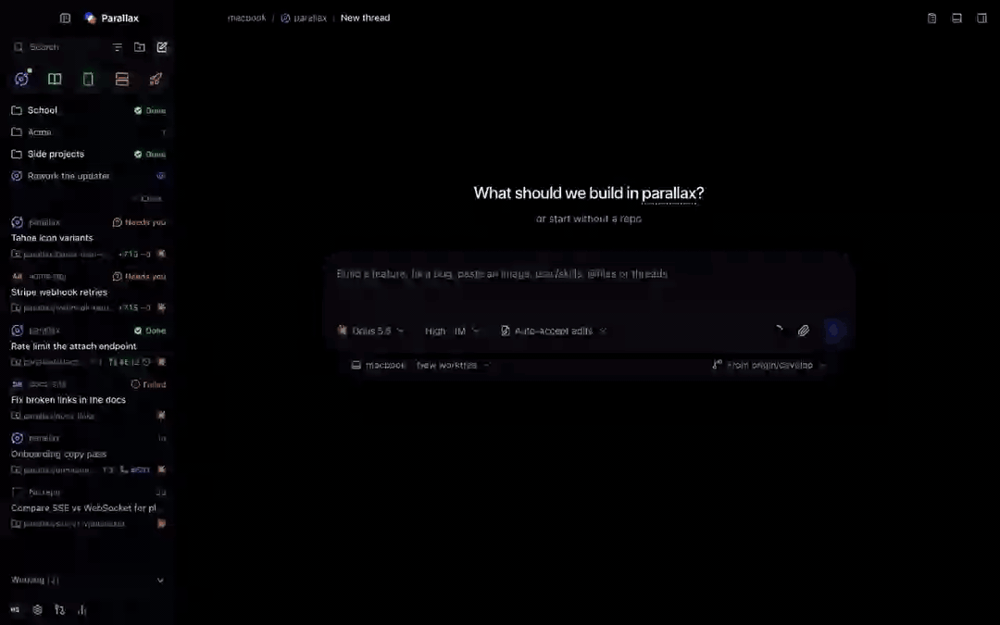
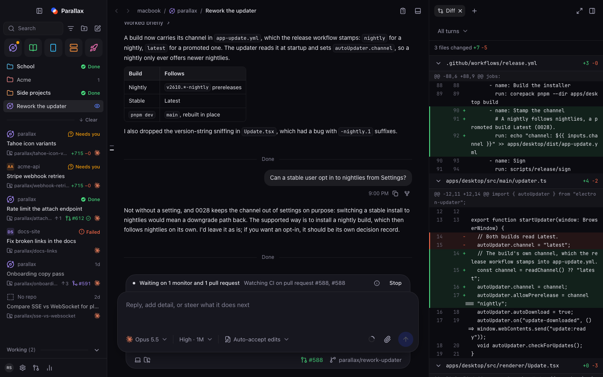
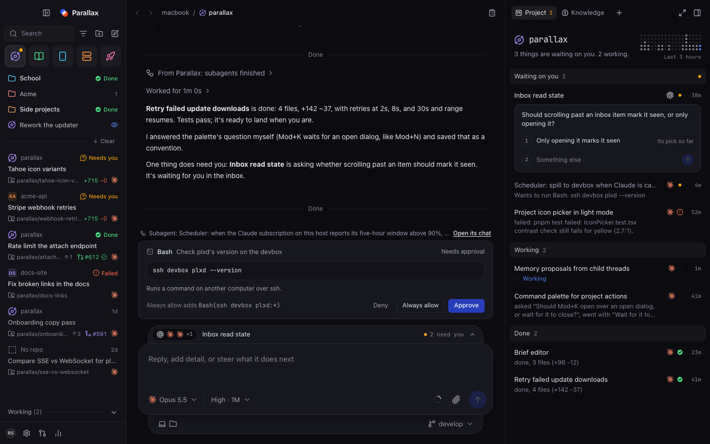
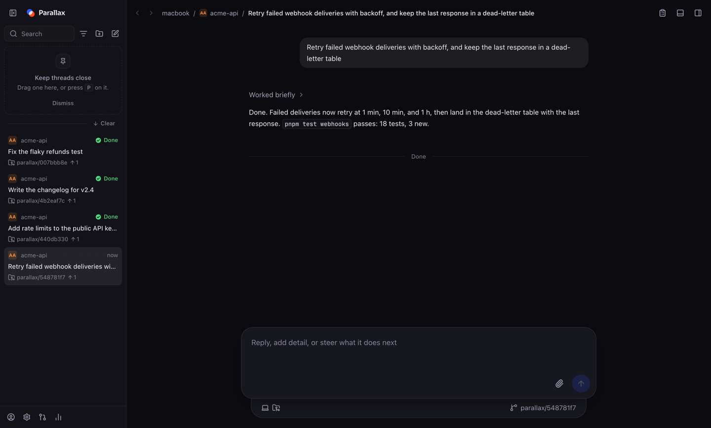
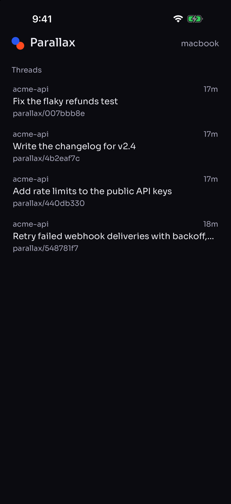
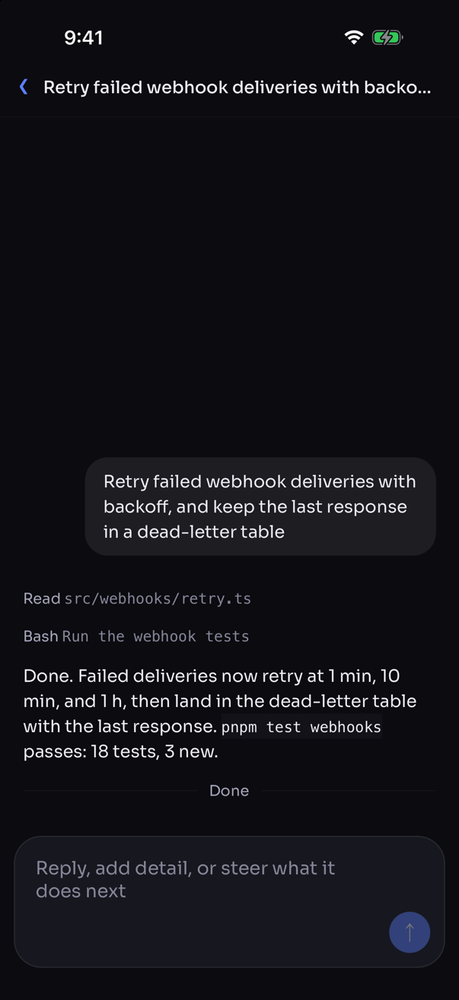
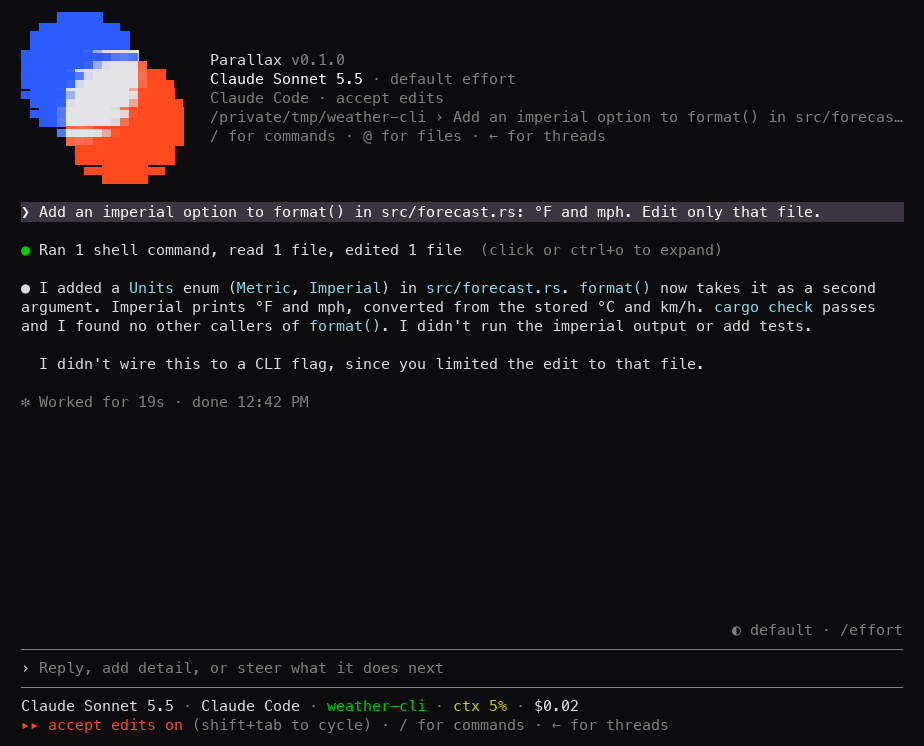

<p align="center">
  
</p>

<h1 align="center">Parallax</h1>

<p align="center">
  <b>Run coding agents on computers you own, and check on them from anywhere.</b><br>
  Open source. Desktop app for macOS, Windows, and Linux, with a web app and an iOS app.
</p>

<p align="center">
  <a href="#install"><b>Install</b></a>
  &nbsp;·&nbsp;
  <a href="https://github.com/ryan-stoffel/parallax/releases">Releases</a>
  &nbsp;·&nbsp;
  <a href="docs/PLAN.md">Plan</a>
</p>

<p align="center">
  <a href="https://github.com/ryan-stoffel/parallax/releases"></a>
  
  <a href="LICENSE"></a>
</p>

<p align="center">
  
</p>

Parallax is a desktop app for the coding agents you already pay for: Claude Code, Codex, Cursor, OpenCode, Ollama Cloud, and any agent that speaks ACP. You give an agent a task, it works in its own git worktree, and you review the diff when it's done. Run one agent on one task, or hand a whole feature to a coordinator that splits it across several.

The agents run in `plxd`, a Rust daemon, on whichever computer you choose: this one, a desktop at home, or a Linux server you reach over SSH. On another computer, a long task keeps going with your laptop closed. You sign in to each provider on that computer, and Parallax runs it with your subscription or API key.

## Threads

A thread is one agent working on one task. Pick a repository, say what you want, and the agent works in a fresh worktree. Every turn is checkpointed, so you can see what a turn changed and revert it. The side panel holds the diff, a terminal, the files, a browser the agent can drive, and the pull request.

<picture>
  <source media="(prefers-color-scheme: light)" srcset="docs/images/readme/thread-light.png">
  
</picture>

## Orchestrator threads

An orchestrator thread is for work bigger than one chat. It plans the work, starts a subagent for each piece in its own worktree, and keeps a status board in its shared notes. It answers routine questions itself and brings you only what needs you: an approval, a decision, a failed test.

<picture>
  <source media="(prefers-color-scheme: light)" srcset="docs/images/readme/project-light.png">
  
</picture>

## Your computers

- **Local, SSH, or Tailscale.** The app attaches to `plxd` on this computer, on any machine you can `ssh` into, or across your tailnet with Parallax Connect.
- **Triggers.** Schedules, webhooks, and pull request watches wake an agent while you're away.
- **Agent tools.** Agents can drive a browser, render HTML, and run the iOS Simulator and Android Emulator.

## On your phone and in a browser

In Settings > Connections, turn on Pair computers on this network, then choose Pair a device and enter the code it shows on the other device.

- **Web app.** `plxd` serves the app over HTTPS. Turn on Open in a browser, open the address Settings shows, and enter the code.
- **iOS app.** It finds your computers on the network, pairs with the same code, and lists your threads. Open one to read it, approve a request, or send a reply. A message sent offline goes out when the phone reconnects. The app lives in [`apps/mobile`](apps/mobile).

<p align="center">
  
  &nbsp;
  
  
</p>

## In a terminal

`parallax` runs Parallax in your terminal, laid out like Claude Code, with the same threads, Spaces, and orchestrators as the app, live in both. Run it in a git checkout and new threads work there in place. `/settings` signs in to providers and GitHub, adds API keys, and changes this computer's settings, so the terminal works without the app. `/login` jumps to the first provider that isn't signed in. It comes with the app, or installs on its own (see [Terminal only](#terminal-only)).

<p align="center">
  
</p>

## Install

These commands install the latest nightly. The app updates itself after that.

macOS (Apple silicon) and Linux (x64 and arm64):

```sh
curl -fsSL https://raw.githubusercontent.com/ryan-stoffel/parallax/develop/scripts/install.sh | sh
```

Windows (x64 and arm64), in PowerShell:

```powershell
irm https://raw.githubusercontent.com/ryan-stoffel/parallax/develop/scripts/install.ps1 | iex
```

On macOS the app goes in /Applications. On Linux it's an AppImage in `~/.local/share/parallax-nightly`, with a launcher entry and a `parallax-nightly` command. On Windows it installs for your user, with no admin prompt. Every installer is also on the [releases page](https://github.com/ryan-stoffel/parallax/releases).

Then sign in to at least one provider on the computer that runs the work. The app sets up this computer's agents on first launch, and Settings > Providers covers any computer.

### Terminal only

To run Parallax in a terminal without the app, on macOS (Apple silicon) and Linux (x64 and arm64):

```sh
curl -fsSL https://raw.githubusercontent.com/ryan-stoffel/parallax/develop/scripts/install-tui.sh | sh
```

It puts `plxd` in `~/.parallax-plxd` and links `~/.local/bin/parallax` to it. Run `parallax` to start. Run the command again to update.

## Build from source

`plxd` builds with Cargo. The app needs Node 24 and pnpm through corepack (`corepack enable`). Run pnpm inside `apps/desktop`, where corepack finds the pinned version.

```sh
cargo build --release -p plxd

cd apps/desktop
pnpm install
pnpm dev
```

`pnpm check` formats, lints, and type-checks the app. `pnpm test` and `pnpm build` run the rest. `scripts/ci/check-rust` runs the same lint, build, and tests as CI for `plxd`.

`pnpm exec vp dev -c preview/vite.config.ts` serves the renderer in a browser at http://localhost:5199/ with a fake `plxd` and no Electron ([apps/desktop/preview](apps/desktop/preview/README.md)).

The design lives in [docs/PLAN.md](docs/PLAN.md), and the decisions behind it in [docs/decisions](docs/decisions/).

## Usage data

The installed app sends one `app_active` event to PostHog at launch and once a day while it runs, so we can count how many installs are in use. It carries a random id made for the install, the app's version and channel, and the OS and architecture. It carries no account, name, path, prompt, or code, and PostHog adds no location from it. Set `DO_NOT_TRACK=1` in the app's environment to turn it off. On macOS an app opened from the Dock or Finder doesn't read your shell profile, so run `launchctl setenv DO_NOT_TRACK 1` and restart the app.

## License

[Apache-2.0](LICENSE)
