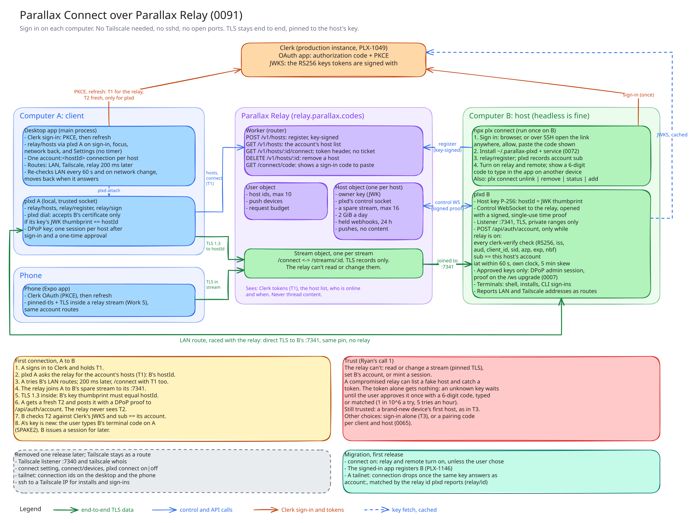

# 0091: Parallax Connect runs over Parallax Relay and account sign-in, without Tailscale

- Status: proposed, waiting on Ryan's four calls below; once accepted it replaces [0056](0056-parallax-connect.md)'s transport, discovery, and plx-connect sections, amends [0068](0068-relay.md)'s identity section and [0065](0065-remote-reach.md)'s mobile amendment (PLX-983), and keeps [0072](0072-connect-stays-up.md)
- Date: 2026-10-29
- Issue: PLX-1148

The diagram's source is [0091-connect-over-relay.excalidraw](0091-connect-over-relay.excalidraw). Open it at excalidraw.com to edit it, then export it as SVG over the file above.

## Context

Parallax Connect (0056) works only when every computer is on one Tailscale tailnet. plxd listens on its Tailscale IPv4, port 7340, and admits a connection after `tailscale whois` names its own untagged user. The app finds computers with `connect/devices` (`tailscale status`), reaches them with `plxd dial <tailnet ip>`, and runs installs and CLI sign-ins on them over ssh to the Tailscale IP (`apps/desktop/src/main/hosts.ts`, `sshOf`). The phone reaches them the same way (PLX-983). plx-connect's `add` needs ssh and Tailscale on both ends. Tailscale is in about 50 files across plxd, the protocol, the store, the desktop app, the phone, and plx-connect. Ryan wants Connect to be Parallax's own tunnel, so Parallax controls every part of it, and as close to T3 Connect as possible.

T3 Connect, read at T3 Code `a773dc38` (`docs/internals/t3-connect.md`, `remote.md`, `environment-auth.md`, `docs/user/remote-access.md`):

- **Setup.** `npx t3 connect` on the host signs in with Clerk, offers the background service, and links the environment. A CLI with a browser uses loopback PKCE, started on the hosted `/connect` page so sign-in survives the redirect. Over SSH or headless it uses Clerk's OAuth device authorization grant: the CLI prints a link and a short code, the user approves on any device, and the CLI polls Clerk's token endpoint. `t3 connect unlink` stops exposure and keeps the sign-in. `t3 connect logout` clears it.
- **Discovery.** Any device signed in to the same account lists the account's environments and picks one. No pairing. The list has no timer: it refreshes when a screen that shows it opens, when the network comes back, and when the sign-in changes (`packages/client-runtime/src/relay/discovery.ts`).
- **Transport.** The relay provisions a managed Cloudflare Tunnel per environment and the host runs a pinned `cloudflared`. After setup the relay is out of the data path, except webhooks. Cloudflare ends TLS at its edge, so it can read the traffic.
- **Trust.** The relay is "a trusted broker": for a signed-in user with a linked environment, it asks the environment to mint a one-time bootstrap credential bound to the client's DPoP key, and the client trades it with the environment for a session. A compromised relay signing key is outside what DPoP protects.
- **Routes.** A saved environment keeps an ordered route list. The server reports its LAN and tailnet addresses, the client saves them as learned routes, connects over the first route that answers, and while on a later route re-checks earlier ones every minute and on network changes, moving back when one works. Pairing once through T3 Connect is enough to use the LAN at home.
- **Limits.** 3 machines per account, raised by a paid T3 Chat plan. Phones and browsers don't count. Idle tunnels are removed after minutes offline and recreated on wake at the same address.

Parallax already runs most of this. Parallax Relay (0068) is live at `relay.parallax.codes`: plxd keeps one authenticated WebSocket to it, a client signed in as the host's user gets a one-time ticket for a stream, and plxd joins the stream to its own TLS listener, so the relay carries only ciphertext. plxd's listener (0065) has TLS with its own P-256 key, DPoP-bound scoped sessions, 30-second WebSocket tickets, and a public descriptor that reports its LAN addresses as routes. A host's relay id is the JWK thumbprint of that key. Since PLX-1146, signing in to the desktop app registers its own computer and every Connect computer with the relay, and the token stays on the computer where the user signed in. plxd owns terminals (0064), so a remote shell no longer needs ssh.

What's missing: reaching a computer through the relay needs a SPAKE2 pairing code first, computers are found through Tailscale, nothing sets a computer up the way `t3 connect` does, and some installs and sign-ins still use ssh to a Tailscale IP.

## Decision

### Ryan's calls

These change the result and wait on Ryan. The rest of this record assumes the recommended answer to each.

1. **Trust.** Recommended: account sign-in plus a one-time approval of each new device and each new computer, by matching a 6-digit code (below, "Access"). A token a compromised relay catches then gets no session. The other choices are sign-in alone, as in T3, which has no approval step but lets a compromised relay that catches a token get a session on the user's hosts, and a pairing code per client and host (0065), with the account used only to list computers.
2. **Tailscale.** Recommended: remove it from Connect entirely, after one release of migration. The other choice keeps a computer's Tailscale address as an extra direct route.
3. **Delivery.** Recommended: this record first, then one issue and one PR per part (below, "Work").
4. **The npm name.** Recommended: publish the CLI as `plx`, so setup is `npx plx connect` (below, "Setup"). `plx` on npm is held by another user's placeholder (0.0.1, "Coming soon", last changed 2022-06-24), so Ryan asks its owner for it, then npm support under its package name dispute policy. The fallback is `plx-cli` with a `plx` command (`npx plx-cli connect`), which is free today.

### Setup: `plx connect`, like `t3 connect`

- The npm package `plx-connect` becomes `plx`, a CLI with subcommands, and `connect` is one of them, as `connect` is in T3's `t3`. The app ships it as it ships plx-connect today (0072). The old name publishes one last version that prints the new command.
- `plx connect`, run on the computer to add (`npx plx connect`, or the copy the app ships): signs in, installs plxd in `~/.parallax-plxd` with its login service (0072), registers the host with the relay, and turns on `relay` and `remote`. It then waits until the relay reports the host connected, and prints its name.
- Sign-in is the desktop app's Clerk OAuth application, authorization code with PKCE, started on a hosted page as T3 does. When the computer can open a browser, it redirects to a loopback listener and needs nothing pasted. Over SSH (`SSH_CONNECTION` is set), with no display, or with `--no-browser`, the CLI prints the sign-in link instead. The user opens it in a browser on any device, signs in, and allows the computer. The redirect lands on a page the relay Worker serves at `relay.parallax.codes/connect/code`, which shows the authorization code, and the user pastes it into the CLI. The CLI trades it with Clerk for a token, with the PKCE verifier only the CLI holds, so a code seen on that page, by the relay, or over a shoulder can't be used anywhere else. It is one-time and lasts minutes. The page's URL is a registered redirect URI of that OAuth application. The CLI then prints that the computer is signed in to Parallax Connect.
- The token is used once. plxd registers with it (`relay/register`) and records the token's Clerk user as the host's account (below). After that plxd proves itself to the relay with its key on every connection (0068), so nothing keeps the token. Unlike T3, there is no stored sign-in to log out of.
- `plx connect unlink` turns `relay` off and keeps the registration, so webhook URLs and the host id don't change. plxd admits account sign-ins (below) only while `relay` is on, so unlink stops new ones. Sessions already issued stay until revoked in Settings, and `remote` stays on for clients that paired on the LAN. With `relay` off the host also sends no phone notifications and gets no webhooks: the relay holds them for up to 24 hours (0068), then drops them. `plx connect remove` signs in again, since nothing kept the token, and deregisters the host (`DELETE /v1/hosts/<id>`). `plx connect status` prints the account, host id, relay state, and routes. `plx connect add <ssh destination>` stays as a shortcut that runs the same setup over ssh, with the sign-in link and the code prompt shown here. It is the only path that uses ssh, and only once.
- Adding a computer from the desktop app's Add computer wizard shows the command to run there, rather than asking for an ssh destination.

### Discovery: the account lists the computers

- While the app is signed in, it asks the local plxd for the account's hosts (`relay/hosts`) when the sign-in changes, when the network comes back, when the app is focused, and when Settings or Add computer opens, with no timer, as T3 does. It keeps a connection to each other host, with id `account:<hostId>`. This replaces `connect/devices` and `tailnet:<node ID>` ids. A computer added elsewhere shows up the next time one of those happens. A host stays listed, retrying, while it is offline, as 0056's devices do. A listed host's connection retries on its own. One that has stopped retrying, such as one refused as `incompatibleProtocol` before the host's plxd was updated, starts again at the next of those same events, as 0072's discovery revives it today. While the app is unfocused such a host stays down, and focusing the app brings it back. The per-host switch and Remove keep 0056's meaning.
- Names and icons stay host settings (`deviceName`, `deviceIcon`), so they carry over.
- The host id is the thumbprint of the host's key, so the list already says which key the app must reach. The relay's list needs no change.

### Access: a signed-in client gets a session without a code

- **The host is pinned by its id.** A client reaching an `account:` host over any route accepts plxd's certificate only when the JWK thumbprint of its key equals the host id. The relay can't present another key for that id, so it can't stand in for the host or read the stream. SPAKE2 is no longer needed to vouch for the key.
- **plxd records its account.** When the host registers, plxd stores the Clerk user id of the token it was registered with. For PLX-1146's signed registration, where plxd never sees the token, the signing computer's app passes the user id with `relay/sign`. That app reaches plxd over a connection plxd already trusts. The relay never sets it, so a compromised relay can't swap in its own account.
- **plxd checks the token itself.** Inside the pinned TLS, the client posts a Clerk token and a DPoP proof to `/api/auth/account`. plxd makes every check `packages/clerk-verify` makes, against the same production Clerk instance the relay trusts (PLX-1049): RS256 against its JWKS (cached, refreshed on an unknown `kid`), issuer, `exp` and `nbf` with its skew, no `aud`, an OAuth token's `client_id` in the app's allowlist, a session token's `sid`, and `azp` in the allowed origins where present. It also requires `sub` equal to its account, and `iat` within the last 60 seconds by plxd's own clock, with 5 minutes of skew either way. Never by the relay's clock: plxd corrects its relay proofs by the relay's time (0068), and a compromised relay could use that to make an old token look fresh. The skew keeps a computer whose clock is a few minutes off from refusing every sign-in, and stretches how long a captured token works to about 6 minutes. A computer more than 5 minutes off refuses account sign-ins, and logs the offset it measured from the relay so the user can fix its clock. If the client's key is approved (below), it then issues its ordinary DPoP-bound `admin` session (0065), listed in Settings by device and revocable like a paired one.
- **A token goes to a host once.** The client sends a token only to a host it has no session with, and gets a fresh one from Clerk for it (an OAuth refresh, on the desktop and the phone alike), separate from the one it sends the relay to open the stream. After that it uses its session.
- **A new device or computer is approved once.** Sign-in proves the account. Approval proves the request came from one of the user's own devices, so a token alone gets nothing.
  - A host keeps the DPoP key thumbprints of its approved clients and the account's approved host ids. A signed-in client whose key isn't approved gets a pending answer, not a session.
  - Both ends of a pending request show the same 6-digit code, computed from the host id and the client's key thumbprint. A request from any other key, or to any other host, shows a different code.
  - A new computer: `plx connect` ends by waiting for a device. When the first signed-in client reaches it, the terminal shows that client's name and code, and the app shows the same code. Enter in the terminal approves the client on the host, and Confirm in the app approves the host on the client. That client then copies approved client keys and host ids between the new host and the hosts it already has sessions with, so the user's other devices need no step for it.
  - A new device: the first host it reaches sends the pending request, with the device's name and code, to that host's connected approved clients over their end-to-end connections. Approving it on one adds the key on every host that client has a session with.
  - A client uses a host only once one of its approved hosts lists that host id, or the user confirmed it as above. Until then the host shows as a new computer to confirm, and the client sends it nothing but its sign-in.
  - The desktop app on a host's own computer is approved over plxd's trusted local socket. Removing a device in Settings removes its key from every host the removing client reaches.
- **What this trusts.** Clerk, for who the user is, and the relay, only for which hosts to try. A compromised relay can still list a host of its own, receive the fresh token a client sends it, or replay the token a client sent it to open a stream. Pinning stops it reading or changing a stream to a real host, and approval stops it using a token: the real host holds the request pending, and the user sees an approval they didn't start, with a code no device in front of them shows. A brand-new device still takes its first host from the relay until its approval completes, as every T3 client does for every host. Otherwise 0068's "can't forge a stream" holds unless the user approves a request they didn't start. T3's relay mints access with its own key, and Cloudflare reads every byte.
- Pairing with a code (0065) stays for computers that aren't signed in to the same account, and for the LAN without the internet.

### Routes: the LAN first, the relay always

- An `account:` host's routes are its learned LAN addresses first, then `relay:<hostId>`. The LAN addresses come from its descriptor, as 0065 has it, and are dropped when the host stops reporting them. Each route is checked against the pinned id before any credential is sent.
- The app tries the routes as "Speed" below has it and keeps the first that connects. While on the relay, it re-checks the LAN routes every minute, on a network change, and when the app is focused, and moves the connection over when one answers with the pinned key. A route that fails after answering waits 5 minutes before the next try, as T3's supervisor does, so a flaky network can't bounce the connection.
- This is what makes Connect faster than ssh at home: a direct TLS connection on the LAN, the relay only when away, no sshd, no keys to copy, and no ports to open.
- Direct connections across the internet (UDP hole punching) are not in this record. The relay's traffic budget (0068: 2 GiB a host a day) is the reason to add them later.

### Speed: connecting as fast as T3

Once connected, a message makes one trip either way, so the relay matches T3's tunnel. Opening a connection is where the relay costs extra round trips, so:

- **Both routes at once.** The app starts the relay route 200 ms after the first LAN attempt if no LAN route has answered, and keeps whichever connects first. Away from home a LAN address can take seconds to time out, and this stops the app waiting for it.
- **No separate ticket request.** The client opens `/connect/<hostId>` with its Clerk token, and the relay checks it there, instead of getting a ticket first.
- **A spare stream.** plxd keeps one idle stream open to the relay, so the relay joins a new client to it without first asking plxd to open one. It counts against the 16-stream limit.
- **The proof opens the channel.** A client with a session sends its DPoP proof with the WebSocket upgrade to `/ws`, instead of first trading it for a 30-second ticket. The ticket stays for clients that can't set upgrade headers, such as a browser. This saves a round trip on the LAN too.
- **A Durable Object per stream.** Each stream's bytes cross their own Durable Object, not the host's, so a large transfer on one stream doesn't queue another.

That leaves the trip to the relay and the TLS handshake inside it, about what a T3 client spends reaching Cloudflare and opening its tunnel connection. Measured on 2026-10-29, with the host on an iPhone hotspot and the client at home: Tailscale's direct path took 73–125 ms a round trip, and the two legs through Cloudflare's Los Angeles point of presence took 33–116 ms and about 22 ms, so about 55–138 ms through the relay. Work 7 measures the real paths.

### Installs and sign-ins go through plxd

- Agent CLI installs and sign-ins on an `account:` host run in that host's plxd terminals (0064), as its shell already does. `sshOf`'s Connect branch goes away.

### Removing Tailscale

- First release: for a host whose `connect` is on, plxd turns on `relay` and `remote` unless the user chose either one before, as 0068's "one turned off stays off" and `on_unless_chosen` already do, and the signed-in app registers it as PLX-1146 does. Turning on `remote` opens port 7341, which admits only private, link-local, loopback, and CGNAT addresses (0065) and only paired or signed-in clients. A host the user kept off stays on its `tailnet:` connection, and Settings asks to turn on Reach from anywhere for it before Tailscale goes. The app adds `account:` connections beside `tailnet:` ones and drops a `tailnet:` connection once the same host answers as `account:`. A client already connected over `tailnet:` is approved over that connection, so migration asks for no codes. They match by the JWK thumbprint of the certificate key each connection reached, since the descriptor's `hostId` is the certificate's SHA-256 fingerprint, not the relay id.
- The release after both the desktop and the phone reach account hosts (Work 3 and 5): plxd's port 7340 listener, the `connect` setting, `connect/devices`, `plxd dial`'s tailnet addresses, `plxd connect on|off`, `daemon/src/tailnet.rs` and `server/tailnet.rs`, the old plx-connect's `tailscale.mjs`, and the phone's tailnet route go. The phone uses the same account routes as the desktop.

### Limits

- 0068's ceilings hold: 10 hosts per user, 16 open streams and 2 GiB a day per host. Phones and browsers aren't hosts, so they don't count, as in T3. The LAN route keeps most traffic at home off the relay.

## Work

Each is one issue and one PR, in this order once Ryan accepts:

1. plxd: account id at registration, `/api/auth/account` with Clerk verification, approved keys and host ids with pending requests and their codes, and host-id pinning in `plxd dial`.
2. `plx connect`: rename `packages/plx-connect` to `packages/plx`, then sign-in with PKCE (loopback, or a code pasted from the relay's new `/connect/code` page), the approval prompt that ends setup, `unlink`, `remove`, `status`, and `add` over ssh.
3. Desktop: account discovery, `account:` connections, LAN and relay routes started 200 ms apart with re-checks, approving devices and computers, and the Add computer wizard.
4. Desktop: installs and sign-ins on `account:` hosts through plxd terminals.
5. Phone: TLS inside a relay stream in `apps/mobile/modules/pinned-tls`, which today does only pinned HTTPS and WebSockets over URLSession and raw TCP over the tailnet. 0068 lists this as the phone's prerequisite for the relay. Then account routes in place of the tailnet, and approving devices.
6. Remove Tailscale, one release after 3 and 5 ship. Without 5 the phone has no way to reach a computer away from home.
7. Speed, after 1: `/connect` with a Clerk token, the spare stream, a Durable Object per stream, and the proof on the `/ws` upgrade. Connect time and time to the first streamed event over the relay go into `scripts/bench/budgets.json`, and the issue records one comparison with T3 Connect from the same network.

## Alternatives

| Alternative | Why it lost |
| --- | --- |
| Keep Tailscale | Every computer and phone needs a Tailscale account and app, and Parallax controls none of discovery, access, or transport. |
| A Cloudflare Tunnel per host, exactly as T3 | Cloudflare ends TLS, so it reads every thread, against 0068. It adds a pinned `cloudflared` per host, tunnel and DNS provisioning, a reaper, and Cloudflare API calls Ryan pays for. The relay already carries end-to-end TLS. |
| Sign-in alone, as T3 | No approval step, but a compromised relay that catches a token gets a session on the user's hosts. The other answer to Ryan's first call. |
| A pairing code per client and host, with the account only listing computers | Keeps the relay untrusted, but every new computer needs a code from every other one, which is the step T3 Connect removes. This is the other answer to Ryan's first call. |
| Clerk's device authorization grant for SSH sign-in, as T3 | The CLI shows a code, the user confirms it matches in the browser, and the CLI polls, so nothing is pasted. Ryan chose a code shown in the browser and pasted into the CLI, which needs no device grant on the OAuth application and no polling. |
| The relay mints a bootstrap credential, as T3 | A relay's own key could then mint access to every host at any time. With plxd checking Clerk's signature, a compromised relay also needs a fresh token from a client of that user. |
| Our own WireGuard mesh with hole punching | That is rebuilding Tailscale: a coordination server, key distribution, NAT traversal, and a userspace network stack on three OSes. The relay plus the LAN route covers the need now. |

## Consequences

- Setting up a computer takes one command and a sign-in, with no Tailscale, sshd, keys, or open ports, and every signed-in computer and phone sees it.
- plxd verifies Clerk tokens in Rust: RS256 and a JWKS fetch. `ring` already verifies RSA, so no new crypto crate is needed.
- Connect depends on the relay and Clerk being up. A computer that loses the internet is reachable only on the LAN, and only by a client that already holds a session for it.
- Away from home every byte crosses a Cloudflare Durable Object and counts against the host's daily budget. The measured trip was about level with Tailscale's direct path ("Speed").
- Adding a device or a computer takes one approval that T3 doesn't have.
- Existing Connect computers migrate over one release, with no action from the user beyond being signed in.
- Production Clerk (PLX-1049) has to register `https://relay.parallax.codes/connect/code` as a redirect URI of the desktop app's OAuth application.
