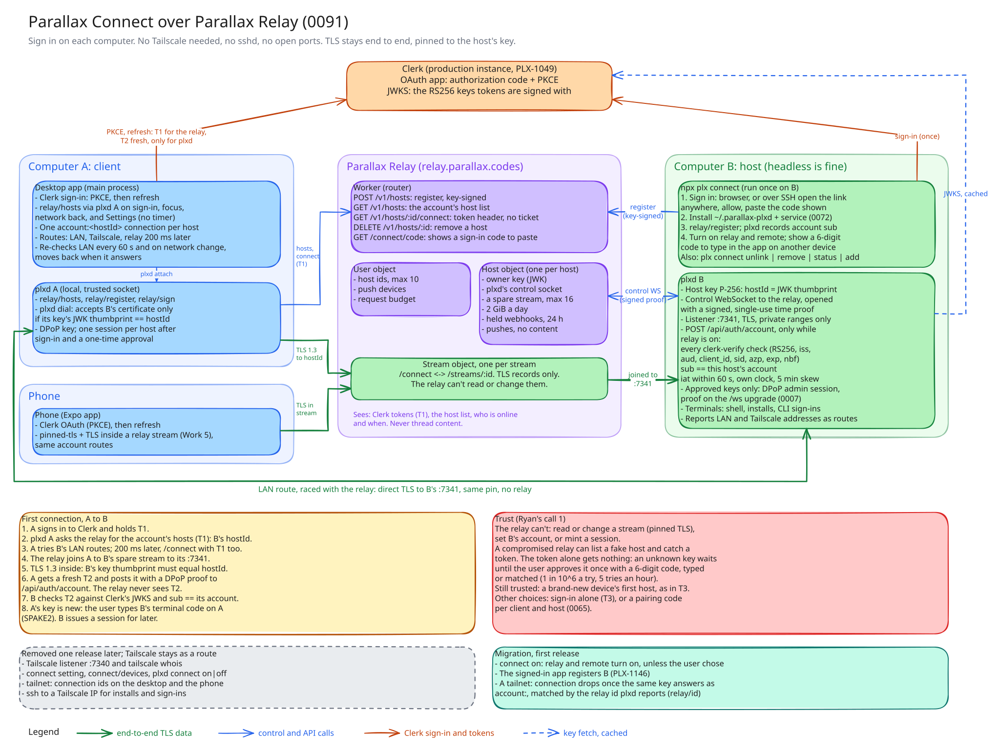

# 0091: Parallax Connect runs over Parallax Relay and account sign-in, with Tailscale optional

- Status: accepted 2026-10-30, with Ryan's four calls below. It replaces [0056](0056-parallax-connect.md)'s transport, discovery, and plx-connect sections, amends [0068](0068-relay.md)'s identity and Cloudflare sections and [0065](0065-remote-reach.md)'s mobile amendment (PLX-983), and keeps [0072](0072-connect-stays-up.md)
- Date: 2026-10-29
- Issue: PLX-1148

The diagram's source is [0091-connect-over-relay.excalidraw](0091-connect-over-relay.excalidraw). Open it at excalidraw.com to edit it, then export it as SVG over the file above.

## Context

Parallax Connect (0056) works only when every computer is on one Tailscale tailnet. plxd listens on its Tailscale IPv4, port 7340, and admits a connection after `tailscale whois` names its own untagged user. The app finds computers with `connect/devices` (`tailscale status`), reaches them with `plxd dial <tailnet ip>`, and runs installs and CLI sign-ins on them over ssh to the Tailscale IP (`apps/desktop/src/main/hosts.ts`, `sshOf`). The phone reaches them the same way (PLX-983). plx-connect's `add` needs ssh and Tailscale on both ends. Tailscale is in about 50 files across plxd, the protocol, the store, the desktop app, the phone, and plx-connect. Ryan wants Connect to be Parallax's own tunnel, so Parallax controls every part of it, and as close to T3 Connect as possible.

T3 Connect, read at T3 Code `a773dc38` (`docs/internals/t3-connect.md`, `remote.md`, `environment-auth.md`, `docs/user/remote-access.md`):

- **Setup.** `npx t3 connect` on the host signs in with Clerk, offers the background service, and links the environment. A CLI with a browser uses loopback PKCE, started on the hosted `/connect` page so sign-in survives the redirect. Over SSH or headless it uses Clerk's OAuth device authorization grant: the CLI prints a link and a short code, the user approves on any device, and the CLI polls Clerk's token endpoint. `t3 connect unlink` stops exposure and keeps the sign-in. `t3 connect logout` clears it.
- **Discovery.** Any device signed in to the same account lists the account's environments and picks one. No pairing. The list has no timer: it refreshes when a screen that shows it opens, when the network comes back, and when the sign-in changes (`packages/client-runtime/src/relay/discovery.ts`).
- **Transport.** The relay provisions a managed Cloudflare Tunnel per environment and the host runs a pinned `cloudflared`. After setup the relay is out of the data path, except webhooks. Cloudflare ends TLS at its edge, so it can read the traffic.
- **Trust.** The relay is "a trusted broker": for a signed-in user with a linked environment, it asks the environment to mint a one-time bootstrap credential bound to the client's DPoP key, and the client trades it with the environment for a session. A compromised relay signing key is outside what DPoP protects.
- **Routes.** A saved environment keeps an ordered route list. The server reports its LAN and tailnet addresses, the client saves them as learned routes, connects over the first route that answers, and while on a later route re-checks earlier ones every minute and on network changes, moving back when one works. Pairing once through T3 Connect is enough to use the LAN at home.
- **Limits.** 3 machines per account, raised by a paid T3 Chat plan. Phones and browsers don't count. Idle tunnels are removed after minutes offline and recreated on wake at the same address.

Parallax already runs most of this. Parallax Relay (0068) is live at `relay.parallax.codes`: plxd keeps one authenticated WebSocket to it, a client signed in as the host's user gets a one-time ticket for a stream, and plxd joins the stream to its own TLS listener, so the relay carries only ciphertext. plxd's listener (0065) has TLS with its own P-256 key, DPoP-bound scoped sessions, 30-second WebSocket tickets, and a public descriptor that reports its LAN addresses as routes. A host's relay id is the JWK thumbprint of that key. Since PLX-1146, signing in to the desktop app registers its own computer and every Connect computer with the relay, and the token stays on the computer where the user signed in. plxd owns terminals (0064), so a remote shell no longer needs ssh.

What's missing: reaching a computer through the relay needs a SPAKE2 pairing code first, computers are found through Tailscale, nothing sets a computer up the way `t3 connect` does, and some installs and sign-ins still use ssh to a Tailscale IP.

## Decision

### Ryan's calls

Ryan answered these on 2026-10-30.

1. **Trust.** Account sign-in plus a one-time approval of each new device and each new computer with a 6-digit code (below, "Access"). A token a compromised relay catches then gets no session. The choices not taken were sign-in alone, as in T3, which lets a compromised relay that catches a token get a session on the user's hosts, and a pairing code per client and host (0065).
2. **Tailscale.** Tailscale stays as an optional direct route (below, "Tailscale becomes an optional route"). The account and the relay replace it for finding and admitting computers. The choice not taken removed it entirely.
3. **Delivery.** One Linear issue per part, and one pull request for all of them (below, "Work").
4. **The npm name.** The CLI is `plx`, so setup is `npx plx connect` (below, "Setup"). `plx` on npm is held by another user's placeholder (0.0.1, "Coming soon", last changed 2022-06-24), so Ryan asks its owner for it, then npm support under its package name dispute policy. Until it transfers, the CLI publishes as `plx-cli` with a `plx` command (`npx plx-cli connect`).

### Setup: `plx connect`, like `t3 connect`

- The npm package `plx-connect` becomes `plx`, a CLI with subcommands, and `connect` is one of them, as `connect` is in T3's `t3`. The app ships it as it ships plx-connect today (0072). The old name publishes one last version that prints the new command.
- `plx connect`, run on the computer to add (`npx plx connect`, or the copy the app ships): signs in, installs plxd in `~/.parallax-plxd` with its login service (0072), registers the host with the relay, and turns on `relay` and `remote`. It then waits until the relay reports the host connected, and prints its name. Amended 2026-11-04 (PLX-1300): plx installs the nightly channel unless `--channel stable` says otherwise, since Parallax has no stable release yet, and `scripts/connect.sh` and `connect.ps1` name the channel so they work with a plx-cli published before this. `plx connect` and `plx connect add` find the release before sign-in and stop, naming the fix, when there's none or its tag is older than `v2610.13019.13940`, the first with what `plx connect` calls. Amended 2026-11-04 (PLX-1355): `plx connect` and both scripts run with no terminal, so a script can set up a computer. No browser opens. Sign-in is the device grant (PLX-1352), which needs nothing on stdin. When the grant isn't available, the pasted code comes from stdin, and when input ends first plx exits 1 rather than 0. Once online it prints one setup code and exits 0 rather than waiting for a device, since plxd keeps the code for its 10 minutes after plx exits. `plx connect status --json` prints stable field names, listed in plx's README. One limit, found on CI's windows-2025 (PLX-1382): `powershell.exe` started directly with `DETACHED_PROCESS` exits 0 in about 150 ms without running its command, whatever its stdio, so no line of `connect.ps1` runs and that exit code means nothing. `cmd.exe` and `node.exe` started the same way run and return their own exit codes, so this is PowerShell's and outside the script. A hidden console (`CREATE_NO_WINDOW`) and a launch through `cmd` both run the script and pass on plx's exit code. Through `cmd`, PowerShell gets a new console as its stdin, so the script takes that for a terminal.
- Sign-in is the desktop app's Clerk OAuth application, authorization code with PKCE, opening Clerk's authorize page directly, as the desktop app does. When the computer can open a browser, it redirects to a loopback listener and needs nothing pasted. Over SSH (`SSH_CONNECTION` is set), with no display, or with `--no-browser`, the CLI prints the sign-in link instead. The user opens it in a browser on any device, signs in, and allows the computer. The redirect lands on a page the relay Worker serves at `relay.parallax.codes/connect/code`, which shows the authorization code, and the user pastes it into the CLI. The CLI trades it with Clerk for a token, with the PKCE verifier only the CLI holds, so a code seen on that page, by the relay, or over a shoulder can't be used anywhere else. It is one-time and lasts minutes. The page's URL is a registered redirect URI of that OAuth application. The CLI then prints that the computer is signed in to Parallax Connect. Amended 2026-11-04 (PLX-1352): over SSH, with no display, or with `--no-browser`, the CLI now uses Clerk's OAuth device authorization grant (RFC 8628), as T3 does, since PKCE already binds the code to the CLI and pasting adds a step without meaningful protection. It prints a link and a short user code, the user approves on any device, and the CLI polls Clerk's token endpoint and continues by itself. Only the CLI holds the device code that redeems the approval, so a user code seen on a screen or over a shoulder gets no token, and a token alone still gets nothing without approval (below, "Access"). A user tricked into approving someone else's code gives that person a token for the account, which still gets no session on any computer. Clerk's discovery document lists the grant when the instance offers it, whether or not this OAuth application has it, so the CLI also asks the device endpoint, which answers 400 `invalid_grant` for an application without the grant. When discovery leaves out the device endpoint, even if it lists the grant type, since the grant can't be used without one, or leaves out the grant type, or the endpoint answers that way, or with `unauthorized_client`, RFC 6749's code for it, the CLI uses the pasted code above with no error, so that flow and the relay's `/connect/code` page stay. Any other failure, such as `invalid_scope`, a malformed discovery document, or an unreachable Clerk, stops the sign-in and shows the reason, since the pasted code would most likely fail too. Ryan enables the grant on the OAuth application in Clerk's dashboard, on each instance (PLX-1353).
- The token is used once. plxd registers with it (`relay/register`) and records the token's Clerk user as the host's account (below). After that plxd proves itself to the relay with its key on every connection (0068), so nothing keeps the token. Unlike T3, there is no stored sign-in to log out of.
- `plx connect unlink` turns `relay` off and keeps the registration, so webhook URLs and the host id don't change. plxd admits account sign-ins (below) only while `relay` is on, so unlink stops new ones. Sessions already issued stay until revoked in Settings, and `remote` stays on for clients that paired on the LAN. With `relay` off the host also sends no phone notifications and gets no webhooks: the relay holds them for up to 24 hours (0068), then drops them. `plx connect remove` signs in again, since nothing kept the token, deregisters the host (`DELETE /v1/hosts/<id>`), and turns `relay` off, so plxd stops reconnecting to a relay that no longer knows it. `plx connect status` prints the account, host id, relay state, and routes. `plx connect add <ssh destination>` stays as a shortcut that runs the same setup over ssh, with the sign-in link and the code prompt shown here. It is the only path that uses ssh, and only once. Amended 2026-11-04 (PLX-1356): `plx connect status` and Settings > Connections also check the path a client takes, with plxd's `relay/check`. plxd keeps no token, so it asks over its control socket, which already proved its key, for an ordinary one-time ticket to itself, counted against the host's 30 stream opens a minute. It opens the stream as a client does, runs TLS inside it pinned to its own host id, and reads its own descriptor. The ticket opens only a stream to that host, so a holder of the host's key gains nothing new. Settings also passes the app's Clerk token, which plxd sends to `GET /v1/hosts` to check the sign-in. The answer names the first part that failed, sign-in, relay, listener, or stream, and what to do. A relay's `ready` says `check: true`, so one that doesn't is reported as needing an update, with no request to time out. Copy diagnostics holds no token, ticket, session, or user id, and only the first 8 characters of the host id. `plx connect status --json` adds the result as `check`.
- Adding a computer from the desktop app's Add computer wizard shows the command to run there, rather than asking for an ssh destination. Amended 2026-11-02 (PLX-1236): it also offers the app. A computer signed in through the app registers on the account but has no terminal to show a code, so its Settings > Connections has Show setup code: main registers it, turns on `relay` and `remote`, waits for the listener, and calls `access/setupCode`, which stays withheld from the renderer. Amended 2026-11-04 (PLX-1306): the wizard shows one command for macOS and Linux and one for Windows. `npx.cmd` works in both cmd and PowerShell, where `npx` is a script the default execution policy refuses. Both pass `-y` and `@latest`, so npx asks nothing and never runs a stale copy. Amended again the same day (PLX-1307): the wizard's commands fetch `scripts/connect.sh` or `scripts/connect.ps1`, which bring Node.js when the computer has none, checked against nodejs.org's SHA-256 list, and then run `npx`. So they need nothing installed. They come from the default branch on GitHub, with the same trust as this repository. A `curl | sh` line is a trade made for a command that works first time on a fresh computer. `npx plx-cli connect` keeps working for anyone who prefers it.

### Discovery: the account lists the computers

- While the app is signed in, it asks the local plxd for the account's hosts (`relay/hosts`) when the sign-in changes, when the network comes back, when the app is focused, and when Settings or Add computer opens, with no timer, as T3 does. It keeps a connection to each other host, with id `account:<hostId>`. This replaces `connect/devices` and `tailnet:<node ID>` ids. A computer added elsewhere shows up the next time one of those happens. Amended 2026-11-02 (PLX-1236): Add computer also asks every 5 seconds while it's open, since the user is waiting on a computer whose setup changes neither this app's focus nor its network. A host stays listed, retrying, while it is offline, as 0056's devices do. A listed host's connection retries on its own. One that has stopped retrying, such as one refused as `incompatibleProtocol` before the host's plxd was updated, starts again at the next of those same events, as 0072's discovery revives it today. While the app is unfocused such a host stays down, and focusing the app brings it back. The per-host switch and Remove keep 0056's meaning. Amended 2026-11-04 (PLX-1306): the app also reads the account's list every 15 seconds while one of its windows is on screen, and runs discovery when the list changed, so a new computer's code prompt appears with no click or focus change. It also probes a new computer again that's listed online but hasn't answered yet, since its listener starting changes nothing in the list. That stays well inside the relay's 120 requests a minute per user. Amended 2026-11-04 (PLX-1312): Remove no longer keeps 0056's meaning for an account computer. It takes the computer off the account: its `relay` goes off when it answers, it leaves the relay, and this app and every computer it reaches forget it, through `access/forgetHost`, which drops it from `approvedHosts` and deletes the saved session. If the relay refuses, nothing changes. Other apps drop it the next time they read the list. Its own app stays off the account at its next start: the app saves the key and account that joined, and when the same pair isn't listed, an app start turns `relay` off instead of registering, so only a sign-in, Reach from anywhere, or an explicit setup brings it back. Setting it up again takes its code. This computer can't remove itself. Limits: a computer that didn't hear the Remove, because it's offline or reached over the relay, keeps `relay` on and retries a relay that refuses it until it's set up again. An offline or older computer can copy its `approvedHosts` entry back at the next sync, which only lets that same key skip the code. A `tailnet:` connection still registers the computer it reaches, until the Tailscale-only path goes. If the relay ever lost its data, every computer with an app would turn `relay` off at its next start, and needs Reach from anywhere turned back on. Amended 2026-11-04 (PLX-1351): not being listed no longer proves a computer left, since a relay that lost its data lists nothing, and that limit is gone. The relay keeps a `removed` list per user, capped at 100: `DELETE /v1/hosts/:id` and a host moving to another user add the id, and registering under that user clears it. `GET /v1/hosts` and `relay/hosts` return it. Only `removed` makes an app drop a computer or turn its own `relay` off at its start. A list that's empty, lacks a computer, or failed changes no setting and closes no connection. The 15-second read also notices a change in `removed` alone. A key that joined and isn't listed, with no mark, never registers by itself and changes no setting, on any relay, since it may have been removed before the relay kept marks, or the relay may have lost its data and its marks. The app says so in a toast and in Settings > Connections, with Set up again, one click that registers it. A relay data loss therefore costs each computer a click, and a removed computer can't put itself back. A key that never joined registers as before. Signing in as another account than the one that joined forgets the last account's computers, which the list used to do. The relay change needs Ryan's deploy (PLX-1371), and the relay goes before the app. Limits: a computer removed before that deploy has no mark, so its app offers Set up again, and other apps list it until someone removes it there. An app from before this amendment still acts on the list alone until it updates. Outages: `relay/hosts` fails with kind `relayUnreachable` for a relay it can't reach or a 5xx, and `clerkUnreachable` when the relay answers 503 `clerk_unreachable`, which it now does when it can't read Clerk's keys and has none cached. A token refresh that gets no answer from Clerk counts as Clerk being down, not as signed out. After two failed reads in a row, unless the OS says this computer has no network, the app names what's down and says computers on this network keep working, in a toast and in Settings > Connections, until a read answers. Direct routes are dialed as before, with or without a token. Amended 2026-11-04 (PLX-1379): the phone acts on `removed` too, on each read. It drops the computer and its session, trust, and waiting request, even for a computer hidden on this phone, and closes its connection. It keeps that computer's request and setup-code counts, since the relay names who left and shouldn't reset a limit. A LAN-paired computer stays, as the account doesn't own it. A list that's empty, lacks a computer, or failed still drops nothing.
- Names and icons stay host settings (`deviceName`, `deviceIcon`), so they carry over.
- The host id is the thumbprint of the host's key, so the list already says which key the app must reach. The relay's list needs no change. Amended 2026-11-04 (PLX-1351): the list's answer gains `removed`, above.

### Access: a signed-in client gets a session without a code

- **The host is pinned by its id.** A client reaching an `account:` host over any route accepts plxd's certificate only when the JWK thumbprint of its key equals the host id. The relay can't present another key for that id, so it can't stand in for the host or read the stream. SPAKE2 is no longer needed to vouch for the key.
- **plxd records its account.** When the host registers, plxd stores the Clerk user id of the token it was registered with. For PLX-1146's signed registration, where plxd never sees the token, the signing computer's app passes the user id with `relay/sign`. That app reaches plxd over a connection plxd already trusts. The relay never sets it, so a compromised relay can't swap in its own account. Amended 2026-11-06 (PLX-1049): plxd stores the issuer it checks tokens against beside the user id, and one recorded before plxd kept it is the development instance's. An account recorded under another issuer counts as none ([0067](0067-clerk-accounts.md)).
- **plxd checks the token itself.** Inside the pinned TLS, the client posts a Clerk token and a DPoP proof to `/api/auth/account`. plxd makes every check `packages/clerk-verify` makes, against the Clerk instance the apps sign in to, which the relay also trusts: the development instance until the account move ships (PLX-1465), then production (PLX-1049): RS256 against its JWKS (cached, refreshed on an unknown `kid`), issuer, `exp` and `nbf` with its skew, no `aud`, an OAuth token's `client_id` in the app's allowlist, a session token's `sid`, and `azp` in the allowed origins where present. It also requires `sub` equal to its account, and `iat` within the last 60 seconds by plxd's own clock, with 5 minutes of skew either way. Never by the relay's clock: plxd corrects its relay proofs by the relay's time (0068), and a compromised relay could use that to make an old token look fresh. The skew keeps a computer whose clock is a few minutes off from refusing every sign-in, and stretches how long a captured token works to about 6 minutes. A computer more than 5 minutes off refuses account sign-ins, and logs the offset it measured from the relay so the user can fix its clock. If the client's key is approved (below), it then issues its ordinary DPoP-bound `admin` session (0065), listed in Settings by device and revocable like a paired one.
- **A token goes to a host once.** The client sends a token only to a host it has no session with, and gets a fresh one from Clerk for it (an OAuth refresh, on the desktop and the phone alike), separate from the one it sends the relay to open the stream. After that it uses its session.
- **A new device or computer is approved once.** Sign-in proves the account. Approval proves the request came from one of the user's own devices, so a token alone gets nothing.
  - A host keeps the DPoP key thumbprints of its approved clients and the account's approved host ids. A signed-in client whose key isn't approved gets a pending answer, not a session.
  - For a new device, both ends of a pending request show the same 6-digit code, made from random values both sides commit to, as Bluetooth's numeric comparison does. The host sends a hash of its random value, the client sends its own, then the host reveals its value. The code is a hash of both values, the host id, and the client's key thumbprint. Neither side can pick its value after seeing the other's, so a relay in the middle of a request gets one chance in a million to make two screens match, however many keys it tries.
  - A host holds one pending request at a time, at most 5 an hour, and drops one after 10 minutes. No new request replaces a pending one before then unless the user denies it, so a relay can't wear the user down with prompts. The client enforces the same on its side, since a fake host sets none: it keeps a request's random value and the host's commitment for its 10 minutes and reuses them when it reconnects, treats a different commitment from that host id as a failed request, and starts a new request only when the user asks, at most 5 an hour. A relay that drops the connection therefore gets no new code to try.
  - A new computer: `plx connect` ends by showing a random 6-digit code and waiting. A signed-in client that reaches the host shows a dialog asking for that code, and the user types it there. The two run 0065's SPAKE2 pairing with it, so the host approves the client and the client approves the host, and nothing is typed in the terminal. Typing proves the user saw the terminal, which a click on the client alone can't. Someone who didn't see it gets one guess per attempt, within the host's 5 an hour, and the code changes after 10 minutes. A typed code is good for one pairing run: a failure, or a connection that drops after the app sent its pairing message, throws it away and the user types it again, and the app allows at most 5 runs an hour per host. So a fake host the relay lists, where the host's own limit doesn't apply, also gets one guess per run the user starts. A typed-code attempt is never held pending: each run succeeds or fails at once and counts toward the 5 an hour. The terminal then prints the approved device's name. That client then copies approved client keys and host ids between the new host and the hosts it already has sessions with, so the user's other devices need no step for it.
  - Amended 2026-11-04 (PLX-1354): Ryan chose Allow on matching codes over typing, with typing as the fallback. When a new computer answers, a signed-in client starts a request there with the commit-reveal above, once, and both screens show its code. The user clicks Allow on the client if they match. Pinning and end-to-end TLS don't change. What the host needs depends on how setup started, because a new computer has no approved keys, and everything it could learn about the user's other devices comes through the relay. So nothing a client holds tells the user's device from a client with a token the relay caught, and the host needs one bit the relay can't touch:
    - A command from Add computer, on the desktop or the phone: it names that device's key with `plx connect --device=<thumbprint>`, which reaches the host through the user and `plxd attach`, never the relay. The key isn't secret. While that setup code lasts, the host takes Allow alone from that key, and refuses any other key's request, so a caught token can't get a session or hold the one waiting slot. This is the one-click flow, and a script can use it too.
    - A bare `npx plx-cli connect`: Allow alone from any client gets no session. The terminal shows the requesting device's name and code, and the user also presses Enter there, or `n` to deny. A terminal with no person at it never approves, whatever its input says.
    - Show setup code in the app: the Allow dialog in that computer's own app is the host's bit, through `access/approve`.
    - Typing the setup code still works in all three, from "Type a code instead". A host that answers a compare with a session at once showed no code, so the client keeps nothing from it and asks for the typed code. This includes setting up again a computer that still has the client's key.
    - A computer added with Allow alone may be a fake one the user clicked through, so it gets lists but never gives them. Its id goes in `allowedHosts`, never `approvedHosts`, and clients use it and copy lists to it, but copy no keys, removals, or host ids from it to another computer. A desktop, and a phone that allowed it or learned the mark from a computer it proved, also trusts no host id it lists. A phone with only an unproved computer's word for the mark can still use a host it lists, as the PLX-1380 amendment says. Clients judge this by the id their connection pins, never what the host says of itself. `allowedHosts` only grows, so a computer one device added this way stays restricted on all of them until it's removed, even if it's real, or typed later. A client keeps a restriction it learns, so the computer that told it can go offline: the desktop keeps each one in its own plxd, and the phone keeps its own and those a computer it proved states in its Keychain with its trust (see PLX-1380 below). It saves the restriction before using the computer, and doesn't use it if that fails: the desktop saves before it sends Allow, which withdraws the request if the save fails, and before it signs in on another computer's word. So a click on Allow marks the computer even if its request then ends. That desktop then takes the typed code until it relaunches, and after that signs in as for any computer in the lists. The desktop copies no lists while its plxd is down. A key approved only there doesn't spread, so that device takes one more Allow on the user's other computers.
    - An older client or plxd reads only `approvedHosts`, so it never sees such a computer and never takes lists from it. An older client treats it as a new computer that needs its typed code, and an older plxd drops the new list, so clients add the computer to it again. A desktop whose own plxd is older can't keep a restriction, so it doesn't use such a computer until that plxd updates, and Allow leaves it the typed code. No version check is needed.
    - The phone's comparison of a new computer takes no session before Allow, and always marks the computer. A new phone's own request still takes a session with no tap, as the PLX-1316 amendment has it. The PLX-1380 amendment stops what such a host says from reaching other computers.
    - **What this adds, beyond a careless click on Allow:** with a bare command, a compromised relay holding a caught token can race the real device for the setup window, so the terminal shows its request. A user who presses Enter without comparing then gives it an `admin` session on that computer. Nothing happens without that key press, and the real device shows no matching code. A careless click on a fake host a compromised relay lists leaves an extra computer on the user's devices, which they may use and send work to. It can't reach their real computers or add keys to them. Ryan's call 1 still holds for a command from Add computer, and for a bare command unless the user presses Enter on a request they didn't start.
  - A new device: the first host it reaches sends the pending request, with the device's name and code, to that host's connected approved clients over their end-to-end connections. Approving it on one adds the key on every host that client has a session with.
  - Amended 2026-11-04 (PLX-1316): a new phone asks on its own once it's signed in, with nothing to tap on it: the first computer online that answers holds the request, and a device that already uses it shows Allow with the code. One Allow covers every computer, as that device copies the phone's key to the rest and the phone trusts the computers its first one lists. Signing in still grants nothing alone, as above, because these computers run agents: Ryan chose this over connecting on sign-in. A denied or lapsed request doesn't start another until the user asks again, and that holds across relaunches. First run shows the reason and Ask again, and later Settings shows it on that computer, where tapping asks again. The phone's Add computer commands name the nightly channel until a stable release has this flow, as the stable releases predate it. Once the phone has asked, a sign-in any computer takes counts as the Allow, since it can come from any of them. While a computer can still hold the request, for its 10 minutes, the phone stays with it if it's online, and past that it passes over one that won't answer. A computer that approved a phone that never asked grants no trust and stops the asking, since each try would leave a session there. A computer new to everyone can still take the code it shows. If no device that already uses the computer it asked is online, nothing prompts, and the request lapses after 10 minutes and waits for the user to ask again. This adds one exposure: a compromised relay could list a host of its own, and since the phone now asks with no tap, that host could answer as if allowed and be used by the phone, with no prompt on any device. It would show up as an extra computer on the phone, where the user may send it work, and it could get the key thumbprints and host ids of the user's computers. It can't pose as a real computer, since their keys are pinned, and it can't add keys, removals, or host ids to one, as PLX-1380 below says. A phone from before PLX-1380 still can until it updates, and whatever one already copied stays.
  - Amended 2026-11-04 (PLX-1380): with no tap, a phone can't tell a host that merely answered its sign-in from a real computer approved on another device. Nothing authenticated reaches it at that point, and a compromised relay can list two fakes that list each other. Marking each such host in `allowedHosts` isn't an answer either: real computers reach a new phone the same way, so one new phone would restrict all of them on every device, for good. So the phone doesn't sort them, and the receiving computer's list decides. It copies to a computer only what comes from that computer, from those that computer's `approvedHosts` names, by the id each connection pins, following their lists in turn, and from those the phone proved itself with a typed setup code or a LAN pairing code. A LAN pairing is judged by the phone's own record of the connection, never by an id, which the relay picks for a computer it lists. A computer in `allowedHosts` adds nothing, even if it's listed or proved. An answer to `access/get` without well-formed lists counts as no list from that computer. In what it copies, the phone names only proved computers as approved, so nothing real comes to list a host nobody verified, and what a fake says reaches only other fakes.
    - Real computers keep syncing through the phone with no proof, because the merge that copies the phone's key to them also lists each of them on all of them. This keeps one Allow covering every computer.
    - The phone keeps a restriction only from its own tap or a proved computer, since a fake could otherwise restrict a real one. Any other restriction counts for the computer that holds it, and for what's copied to that computer.
    - A list can still make the phone use a host it names, which lets a fake add more extra computers on that phone and nothing more.
    - This also keeps a fake out of PLX-1367's signed removals, which a computer takes only from a signer in its `approvedHosts` and not its `allowedHosts`. Through a current phone, a fake's id and any id it names don't reach a real computer's `approvedHosts`, and a computer added with a tap goes only in `allowedHosts`. An older phone can still put them there. A computer that then lists a fake takes its lists through this rule and its signed removals, until the user removes it.
    - A phone from before this kept no record of how it came to trust a computer, so it starts with none proved. Its real computers still sync through their own lists.
    - The cost: a computer the phone adds with a typed code or a tap, while it uses only unproved ones, takes nothing from them through the phone. Another device takes one more Allow there, and the phone shows it. A device approved on the phone also reaches only the computers that accept it by this rule, and its other computers get it from a device that uses them both.
    - The desktop has no such path, as a computer nothing vouches for takes a comparison there, which marks it.
  - With no approved device at hand, such as after losing the only phone, or when a `plx connect` terminal closed before any device reached it, `plx connect approve` on the host shows a new code to type on the device, or its pending request to approve with Enter.
  - A client uses a host only once one of its approved hosts lists that host id, or the user approved it with its code as above, typed or allowed. Until then the host shows as a new computer that needs its code, and the client sends it nothing but its sign-in.
  - The desktop app on a host's own computer is approved over plxd's trusted local socket.
  - Removing a device in Settings marks its key removed. Each host keeps removed keys beside approved ones, and an approved client copies both lists between the hosts it has sessions with whenever it connects, so a host that was offline catches up when it is next reached. A removed key can never be approved again, so the lists merge with no clock, and a device removed by mistake makes a new key and is approved again. Until a host catches up, the removed device's session there still works. Amended 2026-11-04 (PLX-1367): a removal no longer waits for a client to reach an online host. `access/remove`, which `remote/revoke` calls for an approved key, makes plxd sign a statement with its host key over a tag, the account, and the removed keys, and send it on its control socket, or its next one if that's down. The relay passes the string on unread, at most 8 KiB and 30 a minute per host, to the control socket of each of the user's other online hosts, and keeps nothing. A receiving plxd takes it only when the signature checks out for its own account and the signing key's thumbprint is in its own `approved_hosts` and not its `allowedHosts`. A computer added with Allow alone may be a fake one, and clients take no removals from it, so it can't sign one either, even with its id in both lists, which merges can leave. It still receives them. The receiver then applies it as `access/remove` does, which ends that key's live sessions, and doesn't pass it on. The relay holds no approved host's key, so it can't forge a statement, and a host of its own isn't approved. A statement has no time, since a removed key stays removed and replaying a real one changes nothing. The relay learns a thumbprint of a device key it otherwise never sees, and when the removal happened. A compromised relay can withhold a statement. A host that's offline, reconnecting at that moment, or not yet listing the signer in `approved_hosts` catches up from a client as above, and until then the session there still works. A merge sends no statement, so a host catching up tells nobody. A plxd keeps what it hasn't sent in memory, so one that restarts before it reconnects loses it, and those hosts catch up from a client. A receiver checks statements one at a time from a queue of 16 and drops the rest, along with anything too long, so a relay sending many costs it little. A dropped real statement also waits for a client. An approved computer can now remove a device on the others with no client between them, as the lists it gives a client already let it. It can't approve anything this way. The app's own `access/remove` to the computers it reaches stays, since it works on a LAN with no relay. The relay change needs Ryan's deploy (PLX-1371). An older relay or plxd ignores the new frame, and removals travel as before.
  - Amended 2026-11-04 (PLX-1364): a device has full access or is read-only, nothing finer, and it starts with full access. plxd enforces it where it dispatches methods, on requests and on notifications such as `terminal/write`. Every method is named in one exhaustive match, so a new one doesn't compile until someone picks its side, and a name it doesn't know is refused. Read-only reads threads and their files, diffs, and pull requests, and is refused writes, agent starts, sends, approvals, terminals, settings, secrets, and approving or removing devices. It also makes no pairing or setup code, which would let in a device with full access. It gets no `git status` either: status reads changed files through a repository's clean filter, which `-c` can't turn off without the filter's name, so it could run what the repository configures. The git its reads do run has hooks, the filesystem monitor, external diff, textconv, nested submodule diffs, and any fetch for a missing object off, and reads no file through a filter. It also gets nothing that starts another program for its answer, such as `usage/daily`, which runs `npx ccusage`, or `providers/list`, which probes CLIs. `access/get` leaves out a waiting request's code, as it can't answer one.
    - A full-access device or the computer's own app marks a device with `access/setReadOnly`, which closes that device's connections so they reconnect read-only. The mark belongs to the DPoP key, not the session, so signing in again keeps it. It syncs between hosts with the approved and removed lists, because a device is one thing across the user's computers: a mark kept per host would give a limited device full access on the next computer it reaches, and an agent there could reach the first.
    - The mark is one-way, as a removal is. It's a list of its own, so a removal, signed or copied, leaves it, and it leaves a removal. The lists merge by union with no clock, so nothing a merge carries can lift it, and neither a compromised host nor a conflict can raise a device. No method takes it off, not even on the computer's own app: a local un-mark would come back at the next merge from any host still listing it. To give a device full access, remove it and approve a new key. LAN pairing makes a new key each time. An account device starts over with a new key, as the PLX-1400 amendment below has it.
    - Worst cases, as the code stands. An older client's `access/merge` carries only the three older lists, which a merge adds to, so it can't drop the mark. An older plxd ignores the new list and enforces nothing, so the device has full access there until that plxd updates. A plxd downgraded to an older version drops the mark from its own store at its next write to the lists, as its `Lists` doesn't know the field, and gets it back from any host that still lists it when a client next syncs them. If that was the only host listing the mark, the mark is gone and the device has full access. A host that hasn't heard of a mark keeps the device at full access until a client copies it there, as with a removal. A read-only device can't copy anything itself. A compromised host the user verified can mark any device read-only, as it can already remove any. A computer added with Allow alone can't, since clients take no lists from it, so a mark made there stays there.
    - A Tailscale connection on port 7340 has no key, so it stays full access, as do plxd's local socket and `plxd attach` over ssh: limiting a device doesn't limit other ways the user reaches a computer (PLX-1396).
  - Amended 2026-11-04 (PLX-1400): a removed or read-only account device starts over with a new key, from a button in Settings > Connections on that device, which shows only then. A device learns it from a verified computer, inside the pinned connection: a sign-in refused as "this device was removed", or `access/get` listing its key as removed or read-only. A verified computer is one the device's own record proves, which any other may be faking, so what that says of the key doesn't count. On the desktop, that's one its lists approve and not one added with Allow alone. On the phone, by the rule of the PLX-1380 amendment, it's one it set up with a typed code or paired on the LAN, or one of those approves by pinned id, unless marked. So a desktop whose computers were all added with Allow alone gets no button, and neither does a phone that only ever got in by Allow on another device, and their keys must still be deleted by hand (PLX-1414).
    - Starting over grants nothing. The new key has no approval and no session, so it asks as any new device does, and gets nothing until Allow on another device, or `plx connect approve` on one of the user's computers. The approver sees a new device: it can't tell this is the removed or read-only one, and allowing it gives full access. That is how a read-only device gets back to full access, since the mark belongs to the old key. Settings says so before the user confirms.
    - The old key goes. The device deletes it, every session saved with it, and every waiting request's value. A session paired on the LAN has its own key and stays. The old key also goes in the removed lists, so it can't return even from a copy, and a read-only key's sessions end. Its read-only mark stays beside the removal. The desktop removes it on its own plxd with `access/remove` before it replaces the key, which tells the user's online computers as the PLX-1367 amendment has it. The phone keeps it in its Keychain and adds it to what it copies once the new key has a session. A computer that hasn't heard yet keeps the old read-only session, whose key is gone from the device.
    - The limits hold. Only the click starts a request, at one computer at a time, passing over any out of reach, and the rest sign in after its Allow, so one click makes one prompt. The host's one pending request and 5 an hour don't depend on the key, and the client's count per host survives starting over, so repeating it resets nothing. A client gives up on a request after its 10 minutes, whatever a host answers. A request the old key left waiting holds the host's one place until it lapses.
    - It asks only verified computers, one at a time, so each fresh token goes alone. A computer added with Allow alone gets no token while the user expects a prompt, since it could replay one at a real computer with a key of its own, where the prompt would look like the one expected. On the desktop it takes only its typed setup code until a verified computer lets the new key in, and then waits for the user to ask. On the phone, any computer that isn't verified gets no connection until the new key has a session, even if a computer still connected lists it. It takes its typed code, or waits for a computer the phone uses to list it after that. If the desktop relaunches while the request waits, it goes back to signing in to each computer as usual. What remains needs a fake computer the user already allowed, plus unusual timing such as that relaunch: it can catch a token and replay it at a real computer, where the request still needs the user's Allow, and its code won't match the one this device shows.
    - An `access/merge` that lists a waiting request's key now ends that request as approved, so a computer the Allow reaches by copy doesn't prompt too. That key would get a session by signing in anyway, so this grants nothing new.
    - **What this adds:** the user now expects a prompt after starting over, so a request someone else timed to match looks less out of place. The new key's code is bound to that key, so a user who compares the codes still sees it. Anyone holding a read-only phone, or a device with no plxd of its own, can start over and ask, as anyone with the user's token can, and the user must still allow it. Read-only stops a device, not someone with a shell on a computer in the account: on a computer that is also an account host, a new key merged into its own plxd through `plxd attach` reaches the user's other computers with no prompt. Deleting the key file already allowed this, and PLX-1413 tracks it.
- Amended 2026-11-04 (PLX-1373): a computer can also get a session without a Clerk token, with `POST /api/auth/peer` and a proof from its host key, when the receiving computer has `agentWork` on and lists it in `approved_hosts`. The relay takes the same kind of proof for `GET /v1/hosts` and `/v1/hosts/<id>/connect` when both hosts have one owner ([0101](0101-agents-work-across-computers.md)). plxd still keeps no token, and the stream stays pinned to the host id.
- **What this trusts.** Clerk, for who the user is, and the relay, only for which hosts to try. A compromised relay can still list a host of its own, receive the fresh token a client sends it, or replay the token a client sent it to open a stream. Pinning stops it reading or changing a stream to a real host, and approval stops it using a token: the real host holds the request pending, and the user sees an approval they didn't start, with a code no device in front of them shows. A brand-new device still takes its first host from the relay until its approval completes, as every T3 client does for every host. Otherwise 0068's "can't forge a stream" holds, except for a one-in-a-million chance per guess, or a user who approves a request they didn't start. A new device's code gets one guess per pending request, at most 5 an hour. A new computer's typed code gets at most 5 at the real host and one per run the user starts at a fake one, about 10 in its 10 minutes. Comparing a new computer's code adds the exposures its PLX-1354 amendment above states. T3's relay mints access with its own key, and Cloudflare reads every byte.
- **Proxies and corporate certificates.** Amended 2026-11-04 (PLX-1363): plxd's connections to the relay and to Clerk go through `https_proxy` or `HTTPS_PROXY` with HTTP `CONNECT`, unless `no_proxy` or `NO_PROXY` names the host or it is this computer. Credentials in the URL are sent as `Proxy-Authorization` and never logged. It takes an `http://` proxy only, and a setting it can't use fails rather than going direct, since a proxy is usually a network's policy. These limits stay open: plxd sees only its own environment, so a login service on macOS or Linux doesn't get a shell's setting yet (PLX-1388), `plx connect`'s own requests ignore it (PLX-1389), and a proxy limited to TLS 1.2 fails, since plxd builds only TLS 1.3 (PLX-1390).
  - **The relay's TLS also trusts the OS's roots**, beside Mozilla's, through `rustls-native-certs`. They are read once per process, so a root added later counts after a restart, and `SSL_CERT_FILE` or `SSL_CERT_DIR` replaces the OS's store. A TLS-inspecting proxy whose CA is there stands where a compromised relay stands above. It reads host proofs, the Clerk tokens that register a host or open a stream, webhook bodies, and which hosts connect, and it could use a caught token at the relay until it expires, such as to remove the account's hosts. It also reads webhook tokens, so as 0068 says of a compromised relay, it can fire any webhook task that has no signature secret, and replay a signed request under a new delivery id. It can't read a thread: a stream is still TLS to a pinned certificate, and a push is sealed (0100). Approval still stops it using a token on a host. Amended 2026-11-06 (PLX-1462): plxd reads the OS's roots only when Mozilla's refuse the relay's certificate, for any reason, then connects again checking against both, as before, and keeps them for the rest of the process. A network failure isn't retried. Reading macOS's store cost each `plxd dial` about 70 ms. The certificates the relay's TLS accepts don't change.
  - **Clerk's keys keep Mozilla's roots alone.** They go through the proxy's tunnel, but its CA doesn't vouch for them, because a proxy that can forge the JWKS can sign a token for anyone. So behind a TLS-inspecting proxy plxd can't fetch them, and refuses a new account sign-in unless it already holds them in memory from before, which ends when it restarts. Sessions it already granted and pairing with a code still work, and a client behind such a proxy still reaches hosts elsewhere, since only the host fetches keys. A network can exempt Clerk's host from inspection to fix it.
- Pairing with a code (0065) stays for computers that aren't signed in to the same account, and for the LAN without the internet.

### Routes: the LAN first, the relay always

- An `account:` host's routes are its learned LAN addresses first, then its Tailscale address when plxd reports one, then `relay:<hostId>`. A Tailscale route is a direct TLS connection to plxd's port 7341 at its 100.x address, which 0065's listener already admits as a CGNAT address, with the same pin. It answers only for a client on the same tailnet, and it keeps that client's traffic away from home off the relay and its daily budget. The LAN and Tailscale addresses come from its descriptor, as 0065 has it, and are dropped when the host stops reporting them. Each route is checked against the pinned id before any credential is sent.
- The app tries the routes as "Speed" below has it and keeps the first that connects. While on the relay, it re-checks the LAN and Tailscale routes every minute, on a network change, and when the app is focused, and moves the connection over when one answers with the pinned key. A route that fails after answering waits 5 minutes before the next try, as T3's supervisor does, so a flaky network can't bounce the connection.
- This is what makes Connect faster than ssh at home: a direct TLS connection on the LAN, the relay only when away, no sshd, no keys to copy, and no ports to open.
- Direct connections across the internet (UDP hole punching) are not in this record. The relay's traffic budget (0068: 2 GiB a host a day) is the reason to add them later.
- Amended 2026-11-04 (PLX-1365): the user can add a route and reorder a computer's routes, on the desktop (the computer's menu in Settings > Connections) and on the phone (the computer's Routes row). Both keep this per computer on that device, beside the learned routes, and nothing syncs: `addedRoutes` and `routeOrder` in `settings.json` and `machines.json`. An added route is a direct address, a DNS name or IP with a port if it isn't 7341, and is what its text says: no URL, path, or `relay:`, and bad input gets an error for people. The phone takes only IP addresses and `.local` names, and refuses any other name when it's added, with the reason: its pinned requests use URLSession, whose App Transport Security exception in `app.json` is local networking only, so a public name with plxd's self-signed certificate should fail before the pin decides, with nothing to tell the user. This comes from the code and Apple's guidance, not a device test, and it needs no native change. The desktop keeps DNS names. An added route gets the same pin as any route, through the same `open_pinned` and `pinned-tls` paths, so an address with another key gets a TLS handshake and nothing else, and a dial, a sign-in, or a setup code moves on to the next route having sent nothing. Learned routes are still replaced by what the host reports, so one that's dropped takes nothing with it, and it takes its place back if it returns. Only an added route can be removed. A learned one would come back at the next read, and the relay stays because it's the one route that works from anywhere: without it a computer whose direct routes all fail is unreachable until someone edits the list on the same network. With no order saved, nothing changes: added routes start with the learned ones, the relay 200 ms later, and only a connection on the relay re-checks. Moving a route saves an order, and `plxd dial --in-order` and the phone's `race` then start each route 200 ms after the one above it, or as soon as those above it failed, so a reorder decides which route wins when both answer. While on a route, the routes above it are re-checked, the relay's included if it's above, and a relay moved to the top has nothing to move back to, as the user chose. A move from a re-check dials only the route the re-check found, so a slower route above a working one lands there, rather than losing the dial and being moved to again at every re-check. The connection ends before that dial, as any move's does, so a move that fails costs one reconnect. That route then gets no re-check for the same 5 minutes, the relay included, and the next dial tries every route. Moving the routes back to the default order clears the saved one. That's the cost of an order: a route above that hangs costs 200 ms, so three hanging routes hold the relay back 600 ms, and only for someone who chose them. A new route goes after the last direct route in the order, so it can't jump ahead of what the user chose. Limit: plxd's listener still closes any connection from outside the local network (0065), so a port forward works only when the client arrives from a private address, as over a VPN or a NAT that rewrites the source. One from the public internet doesn't connect, and the UI says so. Whether to accept those is PLX-1398's question for Ryan.

### Speed: connecting as fast as T3

Once connected, a message makes one trip either way, so the relay matches T3's tunnel. Opening a connection is where the relay costs extra round trips, so:

- **Direct and relay routes at once.** The app starts the LAN and Tailscale routes together, starts the relay route 200 ms later if neither has answered, and keeps whichever connects first. Away from home a LAN address can take seconds to time out, and this stops the app waiting for it. A connection that lands on the relay moves to a direct route at the next re-check that answers.
- **No separate ticket request.** The client opens `/v1/hosts/<hostId>/connect` with its Clerk token in the `Authorization` header, never the URL, as 0065 and 0068 keep tokens, and the relay checks it there instead of issuing a ticket first. 0068's 30 tickets a host a minute become 30 stream opens a host a minute.
- **A spare stream.** plxd keeps one idle stream open to the relay, so the relay joins a new client to it without first asking plxd to open one. It counts against the 16-stream limit. The host object commits the exclusive claim before returning its id, then owns the stream object’s cleanup notification through `ctx.waitUntil`, independently of the client Worker’s lifetime. That notification no longer delays the client upgrade (PLX-1468). It carries the claim-time 30-second deadline and only arms an existing stream with no client socket, so arrival, close, or hibernation before its delivery cannot re-arm a joined or ended stream. Storage input gates order its alarm write with join’s alarm deletion. Pending RPC work prevents ordinary eviction, per [Cloudflare’s lifecycle contract](https://developers.cloudflare.com/durable-objects/concepts/durable-object-lifecycle/), but is not a durable queue across forced shutdown, which terminates sockets. Control reconnect still reconciles held streams.
- **The proof opens the channel.** A client with a session sends its DPoP proof with the WebSocket upgrade to `/ws`, instead of first trading it for a 30-second ticket. The ticket stays for clients that can't set upgrade headers, such as a browser. This saves a round trip on the LAN too.
- **A Durable Object per stream.** Each stream's bytes cross their own Durable Object, not the host's, so a large transfer on one stream doesn't queue another. The host's object still counts: it admits each stream against the 16 open, and a stream's object reports its frames to it every 8 MiB and when it closes, which is how often 0068 already saves the count. When the host's 2 GiB a day is spent, the host's object closes its streams' objects and refuses new opens. Amended 2026-11-04 (PLX-1358): a stream's object has a unique id, not a name built from the host and a UUID, since a new name costs a global check. The id goes only to plxd, which names it to join, and never to a client. The object checks the host in plxd's path against the host that armed it, which the name used to guarantee. Streams from before this keep their names until they close. Amended 2026-11-05 (PLX-1359): a stream's object still sends each frame on without waiting for the receiver, so plxd holds back what a client over the relay hasn't read, inside TLS, with no Worker change. plxd's WebSocket sends a ping after each 512 KiB and waits for its pong before going more than 512 KiB past what's answered. A client that never answered a ping isn't waited for. One that answered and then stops reading closes after the 90 s any stalled connection gets, which ends the wait, and only its own connection waits meanwhile. A terminal over the relay batches its output in 200 ms, or 50 ms within a second of a keystroke, and output after a quiet moment goes at once. It sends at most 256 KiB a second after a 512 KiB burst, in messages of at most 32 KiB. A flood, or a client that's behind, skips ahead about once a second: the client gets what it hasn't seen, or the last 128 KiB of it, added to what it shows. Reopening the terminal replays the whole history. Stream frames carry up to 64 KiB, so bulk counts its real size against the 16 KiB minimum. Local, LAN, and Tailscale connections don't change.
- Amended 2026-11-05 (PLX-1419): **a stream outlives plxd's control connection**, since it has its own socket and object. Relay link drops come from below the relay's code (PLX-1349), and ending every stream at each one was what a client away from home felt.
  - plxd opens its control socket with `x-parallax-host-streams`, the ids of the streams it still holds. The relay keeps a stream only if it's listed and its object still has plxd's end, and closes the rest, so the 16 stay counted right. plxd's list alone isn't enough, since after a deploy it may still list a socket that just died. A spare plxd still holds stays the spare.
  - A plxd from before this sends no header, and the relay closes all its streams, as before. A relay from before this ignores the header and does the same.
  - plxd pings its control socket every 15 s instead of every 60 s, answered by the host object's auto-response, so a silent link is noticed in 15 to 30 s rather than up to 2 minutes. A stream has only its own socket to tell plxd it's gone, so plxd sends each a protocol ping every 30 s and ends one that doesn't answer by the next. Cloudflare's runtime answers those without waking the object, and doesn't charge for them.
  - Every 5 s, on every OS, plxd reads the wall clock and the source address a route to the internet would use, which sends nothing. A jump in the clock means a wake, and a new address means a change of network. Either reconnects at once, also out of a backoff wait, and gives each stream 10 s to answer a ping. No OS signal is used, since each OS's would be its own FFI for at most 5 s saved.
  - A deploy still ends every stream, so a client reconnects. Measured under `wrangler dev` across a code reload after a steady link, a client redialing as the app does was back in 1 s, or 3 s when plxd wasn't back yet at its first try, inside the 5 s the app shows no disconnect for. Reloads less than a minute apart take longer, as plxd's backoff grows.
- Amended 2026-11-05 (PLX-1424): **plxd tells the relay when a stream's end is gone**, since a dead link's close may never reach the stream's object, and the client would wait for its own heartbeat.
  - When a stream's task ends, plxd sends `{"t":"gone","stream":id}` on the control socket. The relay acts only on an id in that host's own record. The stream's object closes both ends and reports its count, so `gone` can't dodge the daily cap. An older relay ignores the message, and an older plxd never sends it.
  - A failed control connection now also gives each stream 10 s to answer a ping, as a wake or a change of network does. Each of the three stops the spare, which has no client to lose, so it isn't listed, the relay closes it at the reconnect, and a redial doesn't get a dead one. The relay still keeps a spare a plxd lists, for plxd versions from PLX-1419.
  - A spare taken for a client that never reaches the stream's object closes after 30 s, as a stream plxd never joins does, and plxd asks for another.
- Amended 2026-11-05 (PLX-1456): **`gone` waits for the stream's own close.** `gone` travels on the control socket, so it could reach the stream's object before the stream's last frames did, and the object closed the client's end without the answer. Each request in a sign-in or pairing has its own stream, which plxd's end closes once it answered. This explains the relay probe's approval failures with "plxd sent an answer that isn't HTTP" at 05:09 and 05:33 UTC on 2026-11-06, on nightly v2611.10520.12409. An earlier one at 18:51 UTC on 2026-11-05 ran a nightly from before `gone`, and its cause is unknown.
  - When plxd's end closes a stream, it waits up to 10 s for the relay's close in answer, which the object sends only once it passed on every frame before plxd's close. This holds when plxd's listener fails after answering too. A stream the relay closed, or whose close it answered, gets no `gone`. Any other end, such as a failed send, an unanswered ping, or no answer to the close, still sends it. Under `wrangler dev` the answer comes back within about 12 ms.
- Amended 2026-11-06 (PLX-1462): **a sign-in takes one stream.** A connect with a session was already one stream, the spare. A new device's sign-in took three, one per request: `/api/auth/account`, the request's value, and the wait for approval, and the last two opened back to back, so they missed the spare.
  - They now go one after another on one pinned TLS connection, with HTTP keep-alive. plxd's listener keeps a connection only after a 202 from `/api/auth/account` or `/api/auth/approval`, the answers a next step follows, and only when the request sent `Connection: keep-alive`. It waits at most 2 s for the next request, since through the relay a waiting connection holds one of the host's 16 streams. That wait takes one of the pending slots a new connection's request takes (16, and 6 per address), so kept connections can't outnumber them, and with none free the connection closes. Every other answer closes the connection, as before, a refusal included. Each request still carries its own DPoP proof, so a kept connection grants nothing.
  - The client reuses a kept connection only for the same route and pin within 1 s. After a pause for the user, such as comparing codes before Allow, it opens a new one, and the host has closed the old one by then. A kept connection the host closed sooner, such as on a slow link, gets no answer, and the step then goes once more on a new connection with a new proof. Sending the same step twice is safe. A plxd from before this answers `Connection: close`, and the client then opens a connection per request, as before.
  - Measured under `wrangler dev` with 20 ms added on each leg: a new device's sign-in to its approval went from 3 streams and 796 ms to 1 stream and 505 ms. An approved device's sign-in stays 1 stream.
  - A `plxd dial` also no longer reads the OS's root certificates unless the relay's certificate needs them (the PLX-1462 note under proxies above). Against production with a refused token, a dial went from 364 to 252 ms.
  - Stream objects keep the place `newUniqueId` gives them, with no `locationHint`. In production a request to an existing object took 15 ms more than the Worker alone (173 vs 158 ms), so the object is already near. What a round trip pays over T3's tunnel (94 vs 56 ms on 2026-11-06) is each frame's two extra legs through the object, which a hint can't remove.
- Amended 2026-11-09 (PLX-1483): **the first frames go behind the upgrade.** With the proof on the upgrade, a client still waited one round trip to the computer for the 101 before `initialize` could go. `plxd dial` now sends the lines already waiting on its input, which are the app's `initialize` and first subscriptions (PLX-1480), as frames in the same TLS record as the `/ws` request. The 101, `initialize`'s answer, and the first event come back together.
  - **The TLS handshake says whether a host keeps them.** plxd's listener lists the ALPN protocol `plxd-early-ws` ahead of `http/1.1`, and `plxd dial` offers both. Only when the handshake picks `plxd-early-ws` does the client send anything before the 101. The answer comes from the plxd answering that connection, in the handshake the client already makes, under the pinned certificate. So it costs no round trip, the relay can't change it, and nothing is saved that a rollback could make wrong. A capability saved from an earlier `initialize` was the choice not taken: after a rollback the old host drops whatever part of the frames it read with the request, which breaks the WebSocket's framing and leaves the connection to time out. The handshake's round trips, certificate, and pin don't change. It is TLS 1.3 with no 0-RTT, and nothing is resumed, since each dial builds a new client configuration that holds no earlier session.
  - **The host checks first.** plxd keeps what it read behind the request, under 1 KiB since it reads 1 KiB at a time, as bytes it doesn't parse, and reads nothing more until the upgrade is decided. It then checks what it checked before, in the same order: the session's token, the proof and its key, replay, the browser switch, revocation, and the read-only level. Only after the 101 goes out do the kept bytes reach the WebSocket, so those frames are handled as later ones are, and a read-only device's write gets the same refusal. A refused upgrade is answered as before, and the bytes are dropped unread.
  - **Old and new.** A plxd from before this lists no protocol, so nothing is picked and the client waits for the 101 as before. That covers a host rolled back to an older version, from its next connection. A client from before this offers no protocol and sends nothing early. A browser, URLSession, and OkHttp offer `h2` and `http/1.1` and get `http/1.1`, which they already speak to plxd. A client whose ALPN list has neither `plxd-early-ws` nor `http/1.1`, such as one offering only `h2` or `http/1.0`, now fails the handshake, where the listener used to ignore any list. The gain needs this version on both ends: the plxd that dials, which ships with the app, and the plxd that answers.
  - **Limits.** At most 8 KiB of frames go early, so the request and the frames fit one TLS record. A host that refuses has then read everything the client sent, so its close is clean and the client reads the 401. A client that sent more could lose the refusal to a connection reset, which costs only that client. Lines past 8 KiB go after the 101, and `plxd dial` never waits for input before it sends the upgrade. When an upgrade is refused and the ticket path then opens a socket, the same lines go there, since the host dropped them. When the connection fails after the upgrade went out and before the client read the 101, the client can't tell whether the host ran the early lines, so a caller that pipes a write into `plxd dial` as it starts must not send it again blindly. The app puts only `initialize` and subscriptions there, which belong to the connection.
  - **The 101 still takes one round trip after TLS, and nothing waits for it now.** The host learns who the client is from the client's first flight after the handshake, so it can't admit the session sooner. Admitting it inside the handshake would put the credential in the ClientHello, which means a pre-shared key or 0-RTT, and neither is used here. A TLS client certificate goes in that same flight, so it saves nothing.
  - The phone's `/ws` goes through `URLSessionWebSocketTask` and OkHttp, which can't write before the 101, so the phone doesn't change until PLX-1502.
  - Measured with `scripts/bench/round-trips.mjs` under `wrangler dev`, medians of 10 dials, with 0, 20, and 50 ms added to each direction of every outer connection. A round trip to the computer crosses two of those connections, so it grows by four times the delay. From `connected` to the first event, with the subscription sent behind `initialize`: 7, 91, and 210 ms before, and 2, 0, and 0 ms after. From starting `plxd dial` to the first event: 46, 414, and 955 ms before, and 38, 323, and 744 ms after. That is one round trip to the computer fewer.

That leaves the trip to the relay and the TLS handshake inside it, about what a T3 client spends reaching Cloudflare and opening its tunnel connection. Measured on 2026-10-29, with the host on an iPhone hotspot and the client at home: Tailscale's direct path took 73–125 ms a round trip, and the two legs through Cloudflare's Los Angeles point of presence took 33–116 ms and about 22 ms, so about 55–138 ms through the relay. Work 7 measures the real paths.

Amended 2026-11-06 (PLX-1466): optional diagnostics (`PLXD_CONNECT_TIMINGS=1`) add bounded numeric stderr checkpoints. An opted-in authenticated relay upgrade can return numeric `Server-Timing` durations and a spare-selection flag in response headers, without changing stream payloads, authentication or limits. See [the timer audit](../../scripts/bench/connect-timings.md) for exact boundaries and comparison caveats. Production speed and the remaining T3 gap are not established by local diagnostics.

### Installs and sign-ins go through plxd

- Agent CLI installs and sign-ins on an `account:` host run in that host's plxd terminals (0064), as its shell already does. `sshOf`'s Connect branch goes away.

### Tailscale becomes an optional route

- First release: for a host whose `connect` is on, plxd turns on `relay` and `remote` unless the user chose either one before, as 0068's "one turned off stays off" and `on_unless_chosen` already do, and the signed-in app registers it as PLX-1146 does. Turning on `remote` opens port 7341, which admits only private, link-local, loopback, and CGNAT addresses (0065) and only paired or signed-in clients. A host the user kept off stays on its `tailnet:` connection, and Settings asks to turn on Reach from anywhere for it before the Tailscale-only path goes. The app adds `account:` connections beside `tailnet:` ones and drops a `tailnet:` connection once the same host answers as `account:`. A client already connected over `tailnet:` is approved over that connection, so migration on the desktop asks for no codes. The phone drops Tailscale entirely (below), so a phone set up over Tailscale gets its computers back from the account and is approved once as a new device. A `tailnet:` connection is plain TCP inside Tailscale, with no certificate to match, so the app asks plxd for its relay host id over that connection (a new `relay/id` call), which Tailscale already authenticates, and matches the two by it.
- Every release from the first: plxd finds its own Tailscale address with `daemon/src/tailnet.rs`, as today, and reports it in its descriptor as a route. A computer on a tailnet is still found through the account, and the tailnet is only one more way to reach it.
- The release after the first, so hosts and apps on the old version keep working through one update: the Tailscale-only path goes. That is plxd's port 7340 listener and its `tailscale whois` admission in `server/tailnet.rs`, the `connect` setting, `connect/devices`, `tailnet:` connection ids, `plxd connect on|off`, the old plx-connect's `tailscale.mjs`, and ssh to a Tailscale IP.
- The phone has no Tailscale from the first release, by Ryan's decision on 2026-10-30. It onboards with account sign-in and lists the account's computers, and its routes are the LAN, then the relay 200 ms later. A Tailscale address plxd reports is ignored there. iOS can't hand over a finished TLS connection, so the phone opens two relay streams per connection, one to check the route against the pinned id and one for `/ws`. The spare stream keeps the second cheap.

### Limits

- 0068's ceilings hold: 10 hosts per user, 16 open streams and 2 GiB a day per host. Phones and browsers aren't hosts, so they don't count, as in T3. The LAN route keeps most traffic at home off the relay. Amended 2026-11-04 (PLX-1357): `GET /v1/hosts` gives each host `usage`, its bytes today, the limit, and `resetsAt`, the next 00:00 UTC, when the count starts again. plxd passes it on in `relay/hosts`, and the desktop app and the phone read it from the list they already read every 15 seconds. Both warn from 80% of the cap, and past it say when it resets and that the LAN still works. The `daily_limit` refusal is unchanged, since the list already says this and a refusal only reaches a client that dials. An older relay sends no `usage`, and the apps say nothing. So a slow stream can't keep `usage` short, a stream with counted frames also reports within 5 minutes of the first, on top of every 8 MiB and when it closes. `bytes` can be short by under 8 MiB per open stream for at most that long, and an idle stream reports nothing, so it stays hibernated.

## Work

Each is one Linear issue. All seven land in one pull request, built in this order:

1. plxd: account id at registration, `/api/auth/account` with Clerk verification, approved and removed keys and host ids with pending requests and their committed codes, and host-id pinning in `plxd dial`.
2. `plx connect`: rename `packages/plx-connect` to `packages/plx`, then sign-in with PKCE (loopback, or a code pasted from the relay's new `/connect/code` page), the code that ends setup, `approve`, `unlink`, `remove`, `status`, and `add` over ssh.
3. Desktop: account discovery, `account:` connections, LAN and relay routes started 200 ms apart with re-checks, approving devices and computers, and the Add computer wizard.
4. Desktop: installs and sign-ins on `account:` hosts through plxd terminals.
5. Phone: TLS inside a relay stream in `apps/mobile/modules/pinned-tls`, which today does only pinned HTTPS and WebSockets over URLSession and raw TCP over the tailnet. 0068 lists this as the phone's prerequisite for the relay. Then account routes in place of `tailnet:` connections with no Tailscale route, onboarding with account sign-in, and approving devices.
6. Tailscale as a route: plxd reports its Tailscale address, and the desktop tries it with the LAN, before the relay. Deleting the Tailscale-only path waits one release for migration, as its own issue then.
7. Speed, after 1: `/v1/hosts/<hostId>/connect` with a Clerk token in a header, the spare stream, a Durable Object per stream, and the proof on the `/ws` upgrade. Connect time and time to the first streamed event over the relay go into `scripts/bench/budgets.json`, and the issue records one comparison with T3 Connect from the same network.

## Alternatives

| Alternative | Why it lost |
| --- | --- |
| Tailscale as the only way to connect | Every computer and phone needs a Tailscale account and app, and Parallax controls none of discovery, access, or transport. |
| A Cloudflare Tunnel per host, exactly as T3 | Cloudflare ends TLS, so it reads every thread, against 0068. It adds a pinned `cloudflared` per host, tunnel and DNS provisioning, a reaper, and Cloudflare API calls Ryan pays for. The relay already carries end-to-end TLS. |
| Sign-in alone, as T3 | No approval step, but a compromised relay that catches a token gets a session on the user's hosts. One of the other answers to Ryan's first call. |
| A pairing code per client and host, with the account only listing computers | Keeps the relay untrusted, but every new computer needs a code from every other one, which is the step T3 Connect removes. One of the other answers to Ryan's first call. |
| A code shown in the browser and pasted into the CLI as the SSH sign-in | Needs no device grant on the OAuth application and no polling, and was the first choice over Clerk's device authorization grant. Amended 2026-11-04 (PLX-1352): Ryan moved to the grant, as T3, because pasting adds a step without meaningful protection. The pasted code stays only as the fallback while an OAuth application lacks the grant. |
| The relay mints a bootstrap credential, as T3 | A relay's own key could then mint access to every host at any time. With plxd checking Clerk's signature, a compromised relay also needs a fresh token from a client of that user. |
| Removing Tailscale entirely | Users already on a tailnet would lose a direct route away from home that costs no relay traffic. Ryan kept it. |
| OS roots for Clerk's keys too | Sign-ins would work behind a TLS-inspecting proxy, but that proxy could then forge the JWKS and sign tokens, leaving approval as the only check. Kept out as PLX-1363's default, since a network can exempt Clerk's host instead. |
| Our own WireGuard mesh with hole punching | That is rebuilding Tailscale: a coordination server, key distribution, NAT traversal, and a userspace network stack on three OSes. The relay plus the LAN route covers the need now. |

## Consequences

- Setting up a computer takes one command and a sign-in, with no Tailscale required, and no sshd, keys, or open ports, and every signed-in computer and phone sees it.
- plxd verifies Clerk tokens in Rust: RS256 and a JWKS fetch. `ring` already verifies RSA, so no new crypto crate is needed.
- Connect depends on the relay and Clerk being up. A computer that loses the internet is reachable only on the LAN, and only by a client that already holds a session for it.
- Away from home every byte crosses a Cloudflare Durable Object and counts against the host's daily budget. The measured trip was about level with Tailscale's direct path ("Speed").
- Adding a device or a computer takes one approval that T3 doesn't have.
- Existing Connect computers migrate over one release, with no action from the user beyond being signed in.
- Production Clerk (PLX-1049) has to register `https://relay.parallax.codes/connect/code` as a redirect URI of the desktop app's OAuth application.
- On a network that inspects TLS, a host needs Clerk's host exempted from inspection to accept new account sign-ins (PLX-1363).

Amended 2026-11-06 (PLX-1472): opted-in client upgrades also expose StreamRelay-local
`join_read` (entry through the armed read), `join_ready` (entry through both ready sends,
only when paired), `join_delete_alarm` (elapsed deletion, only when paired), and
`join_total` (entry through lifecycle work, before header/response construction). These
are local monotonic durations in milliseconds, not timestamps. `stream_join` still
measures the Worker's entire object fetch. Its per-request difference from `join_total`
includes RPC transit, pre-entry queue/wake/gates, and response overhead. It cannot
separate those causes or establish that a storage gate caused production delay. Read
and alarm durations include awaited scheduling/storage latency, not just CPU time.
The entry-to-ready and read windows are nested inside total and must not be summed.

For an opted-in spare claim, the existing background taken RPC records volatile
`taken_entry=1`, `taken_read` (entry through armed read), `taken_alarm` (alarm write
elapsed), `taken_total` (entry through completion), and `taken_outcome` (1=set,
2=skipped because joined or ended). Entry/outcome are numeric flags. Join snapshots only
stages already observed in its own uniquely armed stream object. Missing stages mean
unfinished or unavailable, including after eviction, on a non-spare or legacy ticket
claim, or if taken has not entered yet. Absence does not prove taken never ran. These
observations are never persisted, awaited, fetched separately, or reused across armed
streams. No cross-machine clocks are subtracted. The Worker forwards the opt-in only
after admission and emits these headers only on successful client upgrades. New fields
are finite and bounded to 0–60,000; older daemons ignore them and newer daemons accept
headers without them. Diagnostic defaults, all existing storage awaits/gates and stream
lifecycle ordering stay unchanged. This diagnostic establishes no latency saving or
product parity claim and does not authorize production deployment.

Amended 2026-11-09 (PLX-1493): **a stream's alarm writes no longer hold what a client waits for.** Cloudflare holds everything a Durable Object sends, a 101 and a WebSocket message included, until each storage write before it is confirmed by three of five followers in other data centers ([output gates](https://developers.cloudflare.com/durable-objects/api/sqlite-storage-api/), [SQLite in Durable Objects](https://blog.cloudflare.com/sqlite-in-durable-objects/)). Setting an alarm also waits for the alarm's scheduler before it commits, behind the scheduler update a deletion left in flight (workerd's `actor-sqlite.c++`). A spare connect made three such writes in the stream's object: the claim set an alarm, the join deleted it, and the first frame set the report's. The 101 and `ready` waited for the first two, and plxd's TLS reply waited for the third. In production that showed as an inner TLS handshake 45 ms longer than the inner WebSocket upgrade on Wi-Fi and 141 ms longer from a GitHub runner, where both are one round trip, and as a `stream_join` with two modes near 35 and 80 ms. Per connect, inner TLS tracked `stream_join` (r = 0.90 and 0.72).

- The stream object's alarm writes on a client's path, which are the claim's, a join's, and a frame's, pass `allowUnconfirmed`. They only bound a wait or time a report, so nothing a client is sent depends on one. A write that then fails still resets the object, which drops both ends. plxd's `gone`, or the alarm that did reach disk, then frees the stream's place, as for any object that reset. The host object's writes, the spare's claim included, stay confirmed before their answer leaves, and so do a stream's `arm` and its end.
- The Worker asks the anonymous limit and checks a client's token at the same time, and waits for both before anything reaches an object. The limit's refusal still comes first. On production the Rate Limiting binding answered at once on some connections and took about 30 ms on others in Los Angeles on 2026-11-09. On staging it answered in 0 ms every time, so this saved nothing there.
- The JWKS is cached per isolate, and most connects reach an isolate without it: `auth` was 0 in 4 of 30 connects from the runner and in none of 90 on Wi-Fi, and on staging a fetch took 32 to 41 ms. A cache isolates share is PLX-1505.
- An opted-in upgrade also returns `limit` (the anonymous limit's answer, from the request's start), `jwks` (the JWKS read, only when this request made one), `host_hop` (a call to the host's object that does nothing, made beside the stream's join once `open` answered), and `worker` (the request's start through the stream's 101). `auth` now starts with the request too and runs beside `limit`, so the two overlap. What `host_open` takes over `host_hop` is the host object's own work, with the claim's confirmation. They come after the older fields, so a plxd from before this prints what it did, and plxd now reads 24 entries, not 16.
- Under `wrangler dev` a write is confirmed at once, so none of this shows there. Measured on staging ([0068](0068-relay.md), PLX-1495) from a GitHub runner, 30 connects before and 30 after, four minutes apart, medians: inner TLS 135 to 27 ms, `stream_join` 56 to 21 ms, connect 381 to 267 ms, first event 467 to 356 ms. A build with no alarm write at all in the stream's object did no better, so the hold those writes caused is gone. What is left in the relay's upgrade there, of about 150 ms: about 40 ms Cloudflare takes to run the Worker at all, which a 404 that does no I/O pays too, the JWKS fetch, 36 ms for `host_open` of which `host_hop` is 5 to 8 and the rest is the spare claim's write being confirmed (PLX-1506), and 16 to 21 ms for `stream_join`. Production's gain needs Ryan's deploy and a Wi-Fi run.
- With the hold gone, a handshake that finishes in under 40 ms meets a 40 ms wait on the inner WebSocket upgrade on a Linux host, which is plxd's listener leaving Nagle on, not the relay (PLX-1512).
